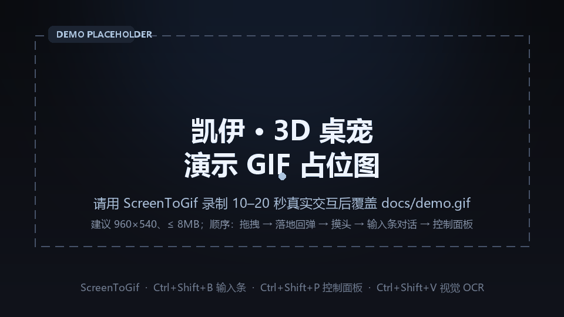

<div align="center">

# 凯伊 · 3D 桌宠

**Kaiyi Desktop Pet** · `aa3dpet`

常驻 Windows 11 桌面的透明置顶 3D 角色 —— 纯本地 AI 对话、GLB 骨骼动画、物理单摆拖拽、NPR 卡通渲染，默认零按次计费。

`v3.1.0-safe-viewport` · 契约 1.35.0 · M31

[核心亮点](#核心功能亮点) · [快速开始](#快速开始) · [热键速查](#热键速查表) · [技术架构](#技术架构) · [ADR 索引](#adr-索引) · [贡献](CONTRIBUTING.md)

</div>

---

## 演示



> 🎬 **演示 GIF 占位符**：仓库里的 `docs/demo.gif` 目前只是一张占位图。请用 [ScreenToGif](https://www.screentogif.com/) 录制一段 10–20 秒的真实交互（拖拽 → 落地回弹 → 摸头 → `Ctrl+Shift+B` 对话 → `Ctrl+Shift+P` 控制面板），导出 GIF 覆盖 `docs/demo.gif` 即可。
>
> 录制建议：窗口缩放保持 1.0x、画面 960×540 左右、体积 ≤ 8 MB，画面最干净。

---

## 这是什么

一个 **Windows 11 桌面宠物**：角色以无边框、透明、置顶的独立窗口常驻桌面，不占任务栏；鼠标只有真正落到角色像素上才可交互，其余区域点击直接穿透到桌面。

她能在桌面底部自己走动、被拖着甩来甩去、被摸头会害羞、会吸附到你当前窗口的边缘坐下；对话走**本地 Ollama**，语音走**本地 GPT-SoVITS**，记忆存在**本地 SQLite**，视觉 OCR 也走**本地 OpenAI 兼容端点** —— 开箱即用路径上没有任何按 token / 按次计费的外部调用。

> 技术栈：Electron 33 + Three.js（glTF 2.0 / GLB）+ TypeScript + esbuild + better-sqlite3。
> 只用 Windows 11 x64；角色模型、贴图、语音等资产需自备（仓库不内置，见[资产说明](#资产与版权)）。

---

## 核心功能亮点

### 🧠 纯本地零成本 AI

- 默认接 **Ollama**（`http://127.0.0.1:11434`，模型 `qwen3:4b`），本地 LLM 推理，不产生 API 费用。
- LLM / TTS / OCR 三类外部端点**只允许回环地址**，启动期就做白名单校验；远程提供商（OpenAI 兼容 / OpenCode Go）只能由你在控制面板里**显式添加**后才可能被访问。
- 规则 → LLM → 兜底三级分流：LLM 超时/失败时自动降级到规则台词，桌面不卡、不弹窗、不中断。
- API Key 只落本机 `config.json`（已被 `.gitignore` 排除），不进日志、不回渲染进程；面板只显示「已配置 / 未配置」。

### 🦴 GLB 骨骼动画与物理单摆

- 加载标准 **glTF 2.0（.glb）**：自动识别骨骼、动画片段与包围盒，按模型算窗口尺寸与缩放锚点。
- 三层 **HFSM**：Base（idle / walking）、Overlay（speaking / reacting）、Physics（dragged / settling / sitting）；骨骼仲裁保证多层动画互不打架。
- 拖拽 = **受迫单摆**：整身绕抓取点摆动，抓头/抓脚参数不同；松手后走刚度 140、阻尼 12 的回弹弹簧，按落地速度分级压扁（≤3%）。
- 摇晃时按真实侧影剖面自适应限制摆角，并给视口加安全边距，**头发和脚不会被窗口边缘切掉**（ADR 0058 有逐帧取证）。
- 待机时自主行走、七个站姿轮换、微动作池与视线阻尼；摸头/拍头有独立的头部骨骼命中区与官方片段。

### 🎨 NPR 卡通渲染

- 身体与头发使用 **3 阶 Toon 光照**（`MeshToonMaterial` + 硬边 `gradientMap`），面部刻意不参与 Toon 光照，保证贴图原色不被压暗。
- 描边使用 **反向壳（Inverted Hull）**：共享几何 + 共享骨骼的 `BackSide` ShaderMaterial 沿法线外扩，宽度按屏幕像素给（身体 1.5px / 头发 0.8px）。
- 不依赖全屏后处理，窗口透明与 ARGB 混合链路保持简单。
- 表情走贴图合成（眼型 / 嘴型 / 红晕），口型由语音 RMS 包络驱动四档元音 —— 都是"纯贴图 + 纯骨骼"，没有 Live2D 依赖。

### 🔀 多模型热切换

- 控制面板 → **AI 人格 → LLM 提供商**：本地 Ollama、任意 OpenAI 兼容端点、OpenCode Go 三选一，最多 10 个提供商。
- 模型列表可 **动态拉取**（Ollama `/api/tags`、OpenAI 兼容 `/models`），带 🔄 刷新、2 秒节流、单飞与 60 秒缓存；失败仍可手填模型名。
- 切换 / 保存 / 删除后**下一轮对话生效**，不需要重启；在途请求用旧提供商说完。
- 已保存的 Key 不会回到渲染进程：编辑时留空，只有「同提供商 + 同类型 + 同归一化地址」时才由主进程注入旧 Key，地址被改写则要求重新输入。

### 👁️ 多模态 OCR 视觉

- `Ctrl+Shift+V` → 主进程 `desktopCapturer` 截屏 → 本地 OpenAI 兼容 **GLM-OCR**（`http://127.0.0.1:8000/v1`，模型 `glm-ocr`）→ 文本归一化。
- 识别结果作为**一次性**上下文注入下一轮提示词（≤600 字、TTL 120 秒、不写记忆库），用完即清。
- OCR 不可用/超时/空文本时只降级为「这一轮没有画面」，不阻断对话、不弹窗。

### ✨ 还有

| 能力 | 说明 |
|---|---|
| 逐像素命中 / 点击穿透 | 离屏 128×72 alpha 掩膜 + 双线性采样，α≥0.5 才命中；16ms 单轮询器 + 8px 迟滞 |
| 吸附到前台窗口 | `Ctrl+Shift+S` 贴到前台应用上/下边缘并水平居中，播放两段式坐姿；拖拽/点击/目标消失即解除 |
| 长期记忆 | `better-sqlite3`（WAL + FTS5）记录交互与事实，CJK 关键词检索 + 2000 行上限分批淘汰，面板可查看/删除/清空 |
| 本地语音 | GPT-SoVITS `/tts` 取 WAV → Web Audio 播放 + RMS 包络驱动口型，支持打断；失败只降级为字幕 |
| 完整交互闭环 | 全局热键输入条、托盘菜单、800×600 控制面板（物理手感热更新 / 缩放 0.5–2.0 / 角色卡编辑 / TTS 测试 / 记忆管理） |
| 主动搭话 | 空闲 90 秒起评估、冷却 10 分钟、夜间减半；LLM 3 秒超时即沉默，绝不硬凑 |

---

## 快速开始

### 0. 前置依赖

| 项 | 要求 | 是否必需 |
|---|---|---|
| 操作系统 | **Windows 11 x64**（唯一目标平台） | 必需 |
| Node.js | **20.x 或更高**（仓库自带 `package-lock.json`，用 npm） | 必需 |
| Electron | `33.4.11`（devDependency，`npm install` 自动安装） | 必需 |
| 角色模型 | glTF 2.0 `.glb`，默认放在工程根目录 `CH0335.glb` | 必需（仓库不内置） |
| [Ollama](https://ollama.com/) | 默认 `http://127.0.0.1:11434`，模型 `qwen3:4b` | 对话必需 |
| [GPT-SoVITS](https://github.com/RVC-Boss/GPT-SoVITS) | 默认 `http://127.0.0.1:9880` + 3–10 秒参考音频 | 可选（语音） |
| GLM-OCR（OpenAI 兼容） | 默认 `http://127.0.0.1:8000/v1`，模型 `glm-ocr` | 可选（视觉） |

> 所有本地服务只接受 `127.0.0.1 / localhost / ::1`；TTS / OCR 没配也能完整运行，只降级为字幕或无视觉。

### 1. 安装依赖

```powershell
git clone <your-repo-url> aa3dpet-app
cd aa3dpet-app
npm install
```

### 2. 配置本地 AI（推荐默认路径）

```powershell
ollama pull qwen3:4b     # 约 2.5GB，应用不会自动拉取模型
ollama serve             # 默认监听 http://127.0.0.1:11434

copy .env.example .env   # 本机环境变量；.env 已被 .gitignore 排除
# 按需编辑 .env：OLLAMA 地址/模型、TTS 参考音频与文本、OCR 地址等
```

优先级：**进程环境变量 > `.env` > 代码默认值**。控制面板里保存的参数会写入本机 `config.json`（同样不入库，模板见 [`config.example.json`](config.example.json)）。

### 3. 准备角色资产（必须自备）

| 资产 | 默认位置 | 说明 |
|---|---|---|
| 角色模型 | `CH0335.glb`（工程根目录） | 任意 glTF 2.0 GLB；可用 `PET_MODEL_PATH` 覆盖。仓库**不内嵌模型** |
| 嘴型图集 | 模型自带 `CH0335_EyeMouth`，或 `Character_Mouth_Black-Due3Gpre.png`（8×8） | 口型/表情合成依赖；`PET_MOUTH_ATLAS` 覆盖 |
| 表情差分（可选） | `data/expressions/eyes_*.png`、`blush.png` | 缺失时自动降级为「只变嘴型」 |
| 参考音频（TTS，可选） | `data/ref/kaiyi.wav` | 3–10 秒干净人声；`PET_TTS_REF_AUDIO` 覆盖 |

> 📦 **资产获取**：仓库不附带模型 / 表情 / 参考音频。你可以从原始来源自行获取，或把自备资产打包上传到网盘 / GitHub Releases，然后把下载链接填在下面这行（别提交资产本体）：
>
> `<!-- TODO(owner): 在此粘贴你的网盘 / Releases 链接 -->`


### 4. 构建并运行

```powershell
npm run doctor    # 可选：只读体检（模型/图集/台词池/角色卡/Ollama/TTS/OCR）
npm run build     # esbuild 打包到 dist/
npm start         # 启动桌宠（内部会先 build）
```

启动后：

- 桌面底部出现角色；鼠标移到角色上才可交互，空白区域点击穿透到桌面。
- 托盘菜单可呼出输入条、打开控制面板、吸附、重新加载、退出。
- 想看真机自检：`npm run selftest`（主链路 236 项）等，详见[命令表](#常用命令)。

### 可选：接入本地语音（GPT-SoVITS）

1. 启动 GPT-SoVITS 的 `api_v2.py`，监听 `127.0.0.1:9880`。
2. 把 v2ProPlus 权重写进 `tts_infer.yaml` 的 `custom:` 段并重启服务。
3. 在 `.env` 填 `PET_TTS_REF_AUDIO`（WAV/PCM，≥16kHz，3–10 秒）与逐字文本 `PET_TTS_PROMPT_TEXT`；`PET_TTS_PROMPT_LANG` / `PET_TTS_TEXT_LANG` 默认 `ja`。

### 可选：接入 OCR 视觉

1. 起一个 OpenAI 兼容的 GLM-OCR 服务（默认 `http://127.0.0.1:8000/v1`）。
2. 需要时 `Ctrl+Shift+V`；`PET_VISION_DISABLE=1` 可整体关闭。

---

## 热键速查表

| 热键 | 功能 | 被占用时的降级键 |
|---|---|---|
| `Ctrl+Shift+B` | 打开 / 收起**输入条**（唯一可聚焦窗口） | `Ctrl+Alt+B` |
| `Ctrl+Shift+P` | 打开 / 收起**控制面板** | `Ctrl+Alt+P` |
| `Ctrl+Shift+V` | **视觉 OCR**：截屏 → 本地识别 → 下一轮对话注入画面文字 | `Ctrl+Alt+V` |
| `Ctrl+Shift+S` | **吸附**到前台窗口上/下边缘并坐下（再按/托盘可解除） | `Ctrl+Alt+S` |
| `Esc` | 收起输入条 / 控制面板（只 hide，不销毁） | — |
| `Enter` | 输入条内提交话语（输入法组合态下不提交） | — |

> 热键是代码常量，运行期不可配置；默认键被系统占用时自动降级到备用键，都失败只记一条 ERROR，不阻断启动。托盘菜单始终可用。

---

## 常用命令

| 命令 | 用途 |
|---|---|
| `npm install` | 安装依赖（Electron / three / better-sqlite3 等） |
| `npm run build` | esbuild 打包到 `dist/` |
| `npm start` | 构建并启动桌宠 |
| `npm run typecheck` | `tsc --noEmit` 类型检查 |
| `npm test` | 全量单测（63 个测试入口，其中 memory 走 Electron 子进程） |
| `npm run test:memory` | 只跑记忆库用例 |
| `npm run doctor` | 只读环境自检（模型 / 图集 / 台词池 / 角色卡 / Ollama / TTS / OCR） |
| `npm run selftest` | 主链路真机自检（236 项） |
| `npm run selftest:input` | 输入条自检（29 项） |
| `npm run selftest:speech` | 对话 + 发声闭环自检（33 项） |
| `npm run selftest:vision` | 视觉/OCR 全链路自检（16 项） |
| `npm run selftest:fallback` | 缺失模型回退自检（4 项） |
| `npm run panel:shot` | 控制面板真机取证（26 项断言 + 截图，只用本地回环桩） |
| `npm run scale:shot` | 整体缩放逐档取证（0.5x → 2.0x 共 11 帧，拼成 GIF 当录屏看） |
| `npm run swing:shot` | 拖拽摇晃逐帧取证（验证「头发不被窗口边缘切掉」） |

取证产物在 `logs/evidence/`（已忽略）；自检截图在 `dist/selftest/`。

---

## 技术架构

### 进程与窗口

```
Electron 主进程（src/main）                 ← 权威：窗口位置 / 穿透状态 / 配置写盘 / LLM 切换 / SQLite
 ├─ 角色窗口   透明、无边框、置顶、不占任务栏、focusable=false；1.0x 内容区 550×756
 │              └─ renderer/render：Three.js + GLB + HFSM + 表情/口型/Toon/描边
 ├─ 输入条    260×44 独立小窗，唯一可聚焦（Ctrl+Shift+B）
 ├─ 控制面板  800×600，物理手感热更新 / LLM 提供商 / 角色卡 / TTS / 记忆（Ctrl+Shift+P）
 └─ 托盘      输入条 / 面板 / 吸附 / 重载 / 退出
        ▲
        │ contextIsolation + sandbox + 各自最小 preload（src/preload）
        ▼
src/shared：类型、事件、IPC 通道、常量、掩膜/几何/运动等纯函数
```

- **单一定时器**：穿透判定、拖拽位移、行走、回弹、吸附跟随、面板状态轮询共用同一个约 16ms 轮询器，全进程不额外开定时器。
- **主进程权威**：渲染侧只做表现；配置、记忆、外部 HTTP 调用全部在主进程，渲染进程拿不到已保存的 API Key。
- **构建**：单文件 `build.mjs` 用 esbuild CLI 打包（main/preload 为 CJS，渲染页为 IIFE，target `chrome130`；原生依赖 better-sqlite3 / koffi 与 electron 列为 external）。
- **可验证**：63 个测试入口、五套真机自检、面板取证脚本，构成每次改动的回归网。

### 目录结构

```
src/
  main/                  # Electron 主进程
    shell/               # 窗口、命中/穿透、拖拽、输入条、吸附、托盘、控制面板
    orchestrator/        # 规则 / LLM / 兜底分流、提示词、心跳、LLM 客户端
    voice/               # GPT-SoVITS 客户端
    memory/              # SQLite + FTS5 记忆库
    vision/              # 截图、OCR、视觉上下文
    presence/            # 世界事实、应用分类、前台窗口
    runtime.ts           # 装配与 IPC 桥接
  renderer/
    render/              # Three.js / GLB / HFSM / 坐姿 / Toon / 描边 / 表情口型
    input/               # 输入条页面
    panel/               # 控制面板页面
  preload/               # 三个最小 preload
  shared/                # 类型、IPC、常量、纯函数
docs/                    # 契约、模块状态、ADR、联调指南
scripts/                 # 启动器、doctor、Electron 测试 runner
tools/                   # GLB 审查、侧影剖面、片段预览等开发工具
data/                    # 角色卡、台词池、记忆库（运行期生成）
```

---

## ADR 索引

`docs/adr/` 收录了 **55 篇架构决策记录（ADR 0001–0058，0011–0013 已并入 ADR 0015）**。本项目的所有"手感"和"怪癖"基本都能在这里找到原因与取舍依据——改代码之前，值得先翻一遍。

| 主题 | 代表 ADR |
|---|---|
| 平台与窗口 | [0002 命中判定与点击穿透](docs/adr/0002-hit-testing-and-click-through-on-windows.md) · [0003 输入焦点与独立输入窗](docs/adr/0003-input-focus-and-ime-window.md) · [0007 工程根目录迁移](docs/adr/0007-move-project-root-out-of-workspace.md) · [0016 输入条热键与收起](docs/adr/0016-input-bar-window-hotkey-and-dismissal.md) |
| 渲染与动画 | [0009 GLB 加载与模型校验](docs/adr/0009-glb-loading-and-model-validation.md) · [0014 骨骼仲裁与内置动画](docs/adr/0014-bone-arbitration-and-builtin-animations.md) · [0037 Toon 光照与材质替换](docs/adr/0037-toon-lighting-and-material-replacement.md) · [0038 反向壳描边与光环](docs/adr/0038-inverted-hull-outline-and-halo-lighting.md) |
| 交互与物理 | [0035 拖拽抓取/单摆/落地](docs/adr/0035-drag-grab-pendulum-and-landing.md) · [0041 拖拽片段与摸头尾段](docs/adr/0041-drag-clip-decoupling-pat-tail-and-clip-usage.md) · [0049 微动作池与视线层级](docs/adr/0049-micro-motion-pool-and-gaze-layers.md) · [0058 拖拽摆角与视口安全边距](docs/adr/0058-drag-swing-viewport-padding.md) |
| 吸附与坐姿 | [0028 前台窗口吸附与坐姿](docs/adr/0028-foreground-window-snap-and-sitting.md) · [0034 吸附接近与坐姿生命周期](docs/adr/0034-snap-approach-and-sitting-lifecycle.md) · [0057 坐姿退场交接与整体缩放](docs/adr/0057-sit-exit-handover-eyelid-open-and-window-scale.md) |
| AI 编排与记忆 | [0015 本地 TTS + LLM 部署](docs/adr/0015-local-tts-and-llm-deployment.md) · [0020 SQLite + FTS5 记忆检索](docs/adr/0020-memory-schema-and-keyword-retrieval.md) · [0031 主动性 idle-drive](docs/adr/0031-idle-drive-proactive.md) · [0033 预热与心跳解耦](docs/adr/0033-decoupled-warmup-heartbeat.md) |
| 提供商与面板 | [0052 控制面板可调参数](docs/adr/0052-control-panel-tunable-params.md) · [0053 面板人格/模型/记忆](docs/adr/0053-panel-persona-model-and-memory.md) · [0055 LLM 提供商切换](docs/adr/0055-llm-provider-switching.md) · [0056 动态模型列表与 Combobox](docs/adr/0056-dynamic-model-list-and-combobox.md) |
| 视觉 | [0026 走位朝向与表情合成](docs/adr/0026-walking-facing-and-emotion-facial-compositing.md) · [0054 截图 → OCR → 提示词注入](docs/adr/0054-vision-ocr-query.md) |

**决策流程**：新功能先写 ADR（记录背景 / 决策 / 备选 / 后果）→ 再改 `docs/CONTRACTS.md` 并升契约版本 → 最后改代码。契约是"唯一事实来源"，[`docs/CONTRACTS.md`](docs/CONTRACTS.md) 里定义了模块边界、状态/事件白名单、窗口规格与成本红线。

更详细的模块状态、坑位与发布记录见 [`docs/MODULE_STATUS.md`](docs/MODULE_STATUS.md)；本地服务联调见 [`docs/guides/LOCAL-SERVICES.md`](docs/guides/LOCAL-SERVICES.md)。

---

## 隐私、成本与安全

- **默认零外部计费**：未添加远程提供商时，只连本机回环（Ollama / GPT-SoVITS / OCR）。
- **远程显式添加**：OpenAI 兼容 / OpenCode Go 端点只来自你在面板里亲手添加的条目；启动、空闲、定时任务都不探测远程。
- **API Key**：只存本机 `config.json`（已 gitignore）；日志只写「已配置 / 未配置」；模型列表请求不把已保存 Key 发给渲染进程。
- **无遥测**：不收集、不上报任何使用数据。
- **记忆**：本地 SQLite，面板可查看 / 删除 / 清空。
- **截图**：只在用户按 `Ctrl+Shift+V` 时发生；OCR 端点默认回环；视觉上下文只存活一轮，可整体关闭。
- **本仓库**：不含 `config.json`、`.env`、`data/memory.db`、GLB / VRM / OBJ、WAV 等敏感或大体积文件，以上均在 [`.gitignore`](.gitignore) 中排除。

---

## 资产与版权

- 本项目是**非官方粉丝作品**，与角色版权方无关；角色名、模型、贴图、语音等资产的版权归其原始权利人所有，**仓库不附带、也不再分发**这些资产（契约 C-4）。
- 仓库内只包含代码、文档、以及少量用于测试与表情降级的自制/空实现素材；使用本项目所需模型与音频请自行从合法来源获取。
- **商业使用前请自行确认**：模型/贴图/语音的原始许可、第三方依赖（Electron、three.js、better-sqlite3、koffi 等）的许可证兼容性。

## 已知限制

- 仅支持 **Windows 11 x64**，不提供 macOS / Linux 分支。
- 模型 / 表情差分 / 参考音频需自备；仓库不含这些资产。
- 远程 LLM 失败不会自动切回本地：面板显示失败原因，下一轮走规则/兜底并熔断。
- 吸附跟随以「同一个窗口句柄」为准；目标窗口销毁重建时按「目标消失」解除。
- 显示器增删 / DPI 变化后窗口尺寸不会运行期重算，重启生效。
- 全局热键依赖 Windows 注册；被占用时自动降级，托盘菜单始终可用。

---

## 贡献

欢迎 Issue 和 PR！动手前请先读 [`docs/CONTRACTS.md`](docs/CONTRACTS.md)（契约文档），并阅读 [`CONTRIBUTING.md`](CONTRIBUTING.md) 了解分支、测试与提交规范。

## License

[MIT](LICENSE) © 2026 项目所有者

---

<div align="center">

凯伊，毕业快乐。

</div>
