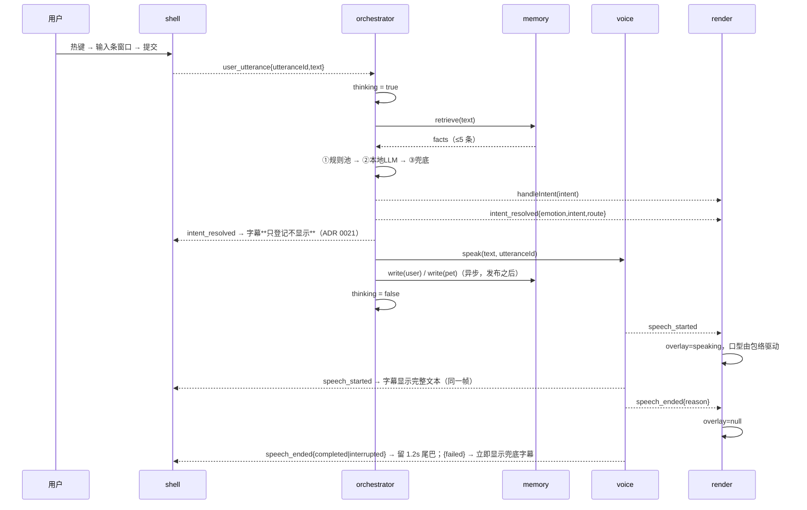
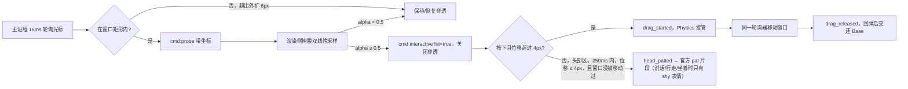
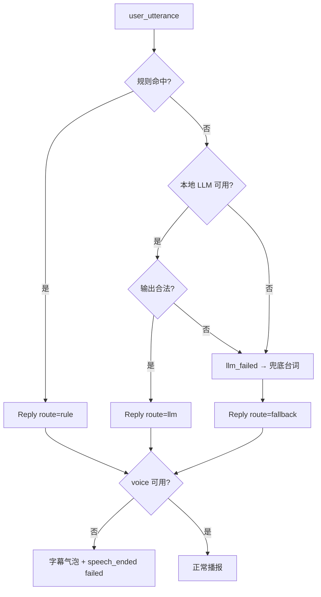

# 3D 桌宠 · 架构契约（CONTRACTS）

| 项 | 值 |
|---|---|
| 契约版本 | 1.28.1 |
| 生效日期 | 2026-11-06 |
| 适用平台 | Windows 11 x64（唯一目标平台） |
| 权威性 | 本文件是唯一事实来源；与代码、口头约定冲突时以本文件为准 |
| 修改方式 | 先写 ADR → 再改本文件 → 版本号按 §15 递增 |
| 配套文件 | `docs/MODULE_STATUS.md`、`docs/adr/*.md` |

## 0. 阅读指引

| 你的问题 | 看哪一节 |
|---|---|
| 这个项目到底做什么、不做什么 | §1、§13 |
| 五个模块谁管什么、谁能调谁 | §2 |
| 窗口、命中、穿透、拖拽的硬规则 | §3 |
| Windows 上踩过的坑、别再试的错路 | §3.6 |
| 某个词到底什么意思（状态、情绪、意图） | §4 |
| "说话时摸头"怎么表现 | §5 |
| 能不能新增一个事件 / 事件怎么命名 | §6 |
| 某个模块对外能调什么 | §7 |
| 数据怎么流动 | §8 |
| 回复怎么产生、失败怎么办 | §9、§11 |
| 能不能联网、能不能用云 API | §10 |
| 接到一半怎么交接 | §16 |

## 1. 项目概述

一个常驻 Windows 11 桌面的 3D 角色（《蔚蓝档案》学生模型，VRM 格式），透明置顶窗口、逐像素命中、可拖拽、可说话、能记住交互历史。参考 Azalea 的表现形态，但**技术上不复用其云端依赖**。

### 1.1 硬约束

| 编号 | 约束 | 说明 | 违反判定 |
|---|---|---|---|
| C-1 | 零按次计费 | 默认路径不产生任何按 token / 按次 / 按分钟计费的外部调用 | 出现需要联网且计费的关键路径 |
| C-2 | 单平台 | 只保证 Windows 11 x64，不为 macOS/Linux 做适配分支 | 出现平台分支代码 |
| C-3 | 本地优先 | LLM、TTS、记忆全部本地；云端仅作显式关闭的 fallback | 默认配置里出现外部域名 |
| C-4 | 视觉资产外部提供 | 模型来自 Kivo.wiki，仓库不内嵌模型文件 | 仓库内出现 `.vrm` 二进制 |
| C-5 | 单实例 | 同一用户会话只允许一个桌宠进程 | 二次启动产生两个窗口 |

### 1.2 目标形态

| 维度 | 目标 |
|---|---|
| 窗口 | 无边框、透明背景、置顶、不占任务栏、可点击穿透 |
| 角色 | 站立锚定在窗口底边中心，窗口默认贴合屏幕工作区底边 |
| 交互 | 全局热键唤出输入条 → 文本输入 → 角色回话；鼠标可拖拽；可拖到屏幕任意位置 |
| 吸附 | 按 `Ctrl+Shift+S`（或托盘项）把窗口贴到前台应用窗口的**下/上边缘**并水平居中，角色播放坐姿；拖拽/点击/目标消失即解除（ADR 0028） |
| 表现 | 呼吸 / 眨眼 / 视线跟随常驻；说话有口型；有情绪表情；被摸头有反应 |
| 记忆 | 交互事件与事实写入本地 SQLite，下次启动可被关键词召回 |

## 2. 模块划分

| 模块 | 一句话职责 | 运行位置 | 明确不负责 |
|---|---|---|---|
| `shell` | 让一块透明窗口"像贴在桌面上的玻璃"：窗口、命中、穿透、拖拽、输入条、字幕气泡 | 主进程 + 渲染进程 | 不理解语义；不碰骨骼动画；不决定说什么 |
| `render` | 把状态与意图变成看得见的动作：VRM 加载、HFSM、混合、口型 | 渲染进程 | 不做决策；不发网络请求；不写数据库 |
| `orchestrator` | 决定"说什么 / 什么情绪 / 什么动作"，输出统一回复对象 | 主进程 | 不播放音频；不绘制；不拼 TTS URL |
| `voice` | 文本 → 本地语音 + PCM RMS 口型包络，支持打断 | 主进程（合成）+ 渲染进程（播放与分析） | 不改写文本；不决定情绪；不做字幕 |
| `memory` | 记住发生过什么，按关键词取回 | 主进程 | 不做语义推理；不引入向量库；不主动调用别人 |

> `presence`（ADR 0030）不是第六个模块，而是主进程内一个**只读工具端口**：
> 它只回答"用户离开键鼠多久、前台是什么应用"，不认识 `Reply`、不产事件、不写库，
> 由 `runtime` 注入 `orchestrator`（见 §2.1）。
>
> `heartbeat`（ADR 0033）同理也不是第六个模块，而是 `runtime` 装配的一个**生命周期节拍器**：
> 它只回答"进程活着还需要做什么"（当前唯一一件 = 冷启动预热），不认识"要不要打扰"、
> 不产事件、不写库、不暴露对外接口方法。它与主动性开关**完全解耦**。

### 2.1 依赖方向（只允许单向）

| 调用方 | 被调用方 | 允许 |
|---|---|---|
| `orchestrator` | `memory`、`voice`、`render`、事件总线 | 是 |
| `orchestrator` | `presence`（只读端口，由 `runtime` 注入；不 import 其实现） | 是（ADR 0030） |
| `heartbeat`（`runtime` 装配） | `orchestrator` 的两个只读事实（`isBusy`/`isLlmDisabled`）、本地 LLM 客户端、`presence` 端口 | 是（ADR 0033） |
| `render` | 事件总线 | 是 |
| `shell` | 事件总线、`render.getState()`（只读轮询） | 是 |
| `voice` | 事件总线 | 是 |
| `memory` | 无（只被调用） | — |
| `render` | `orchestrator` | **禁止**（禁止反向依赖） |
| 任意模块 | 直接 `fetch` 外部域名 | **禁止**（见 §10） |

## 3. 运行边界

### 3.1 进程与外部服务

| 组件 | 位置 | 说明 |
|---|---|---|
| `shell` 主进程侧 | Electron main | BrowserWindow、托盘（含两行只读诊断）、全局热键、指针轮询器、穿透状态机、拖拽循环、前台窗口吸附（Win32 via `koffi`，ADR 0028） |
| `shell` 渲染侧 | renderer | alpha 掩膜采集、命中判定、字幕气泡 |
| `shell` 输入条窗口 | Electron main + 独立渲染页 | 独立非透明小窗，唯一可聚焦窗口（ADR 0003） |
| `render` | renderer | WebGL/Three.js、three-vrm、动画混合、口型通道 |
| `voice` 合成侧 | main | HTTP 调本地 GPT-SoVITS，取 WAV |
| `voice` 播放侧 | renderer | Web Audio 播放 + AnalyserNode 出 RMS 包络 |
| `orchestrator` | main | 规则池、角色卡、LLM 调用、兜底、idle-drive 节拍（ADR 0031） |
| `heartbeat` | main（`runtime` 装配） | 生命周期节拍：15s 一个定时器（`HEARTBEAT_TICK_MS`），**只**做生命周期任务——目前唯一一件是冷启动预热（ADR 0032 D3、ADR 0033 D1）；`model_ready` 到达时立即触发一次（ADR 0033 D2） |
| `presence` | main（只读 Win32） | `GetLastInputInfo` + `GetTickCount` + `GetForegroundWindow` + `GetWindowTextW`/`GetClassNameW`，2s 懒采样；采样点把标题/类名归一化成应用类别（ADR 0030、ADR 0032 D1） |
| `memory` | main | `better-sqlite3` 同步访问 `data/memory.db`（WAL + FTS5，ADR 0020） |
| GPT-SoVITS | 外部本地进程 | `http://127.0.0.1:9880`，`api_v2.py`，用户自行启动 |
| 本地 LLM | 外部本地进程 | Ollama `http://127.0.0.1:11434`，或 OpenVINO 本地推理 |

### 3.2 窗口规格（硬性）

| 项 | 值 | 理由 |
|---|---|---|
| `transparent` | `true` | 角色之外必须完全透出桌面 |
| `frame` | `false` | 无标题栏 |
| `alwaysOnTop` | `true`，层级 `screen-saver` | 需盖住普通窗口，不抢系统级 UI |
| `skipTaskbar` | `true` | 不占任务栏 |
| `hasShadow` | `false` | 透明窗口阴影会画出矩形边 |
| `resizable` | `false` | 由 DPI 与模型配置决定尺寸 |
| `backgroundColor` | `#00000000` | 必须显式透明 |
| `focusable` | **恒为 `false`，运行期禁止修改** | 运行期切换 focusable 在 Windows 上会闪烁、丢置顶、输入法异常（§3.6 P-3、ADR 0003） |
| 尺寸 | 默认 `480 × 720` CSS px，按模型包围盒 × 1.15 校正 | 保证脚底与头顶留白 |
| 锚点 | 角色脚底中心 = 窗口内容区底边中心 | "坐在窗口下沿" |
| 输入条 | **独立窗口**：`260 × 44`、非透明、无边框、置顶、`skipTaskbar`、`show: false` 复用 | 唯一可聚焦窗口，见 ADR 0003 |

### 3.3 命中与点击穿透（规则 R）

| 编号 | 规则 |
|---|---|
| R-1 | 窗口内容只有 canvas 与最少 DOM（字幕气泡）；角色命中**不得**依赖 DOM 元素；输入条不在本窗口（§3.2） |
| R-2 | 命中判定基于 CPU 侧 alpha 掩膜：渲染侧把角色渲染到独立的 `128 × 72` 离屏 RenderTarget，用 `readRenderTargetPixels` 读回。**禁止**对 drawing buffer 调 `readPixels`，**禁止**开启 `preserveDrawingBuffer`（§3.6 P-2） |
| R-3 | 掩膜以窗口内容坐标系定义并覆盖整个 canvas；光标 CSS 坐标按 canvas 尺寸等比映射到掩膜坐标 |
| R-4 | 光标处的命中值 = 掩膜双线性插值；`alpha ≥ 0.5` 判为命中。光标停留在同一掩膜单元内时复用缓存结果，不重复计算 |
| R-5 | 掩膜刷新：光标在窗口矩形内 ≥ 20Hz；光标离开窗口矩形则暂停采集；重新进入且掩膜陈旧 > 100ms 时立即重采一次再判定 |
| R-6 | 穿透恢复由主进程驱动（Windows 上 `forward` 无效，§3.6 P-1）：主进程以 ~16ms 轮询 `screen.getCursorScreenPoint()`，光标进入窗口矩形 → 发 `cmd:probe` → 渲染侧用最新掩膜判定 → 回 `cmd:interactive{hit}` → `hit=true` 关闭穿透并保持，`hit=false` 维持穿透 |
| R-7 | 离开判定带迟滞：光标离开窗口矩形**外扩 8px** 才恢复穿透；穿透状态每次切换后 100ms 内不再切换 |
| R-8 | 拖拽期间强制保持非穿透，直到 `drag_released` 且回弹结束；拖拽期间暂停掩膜采集以省 GPU |
| R-9 | 掩膜采集或离屏渲染失败（上下文丢失、模型未就绪）→ 退回"窗口内容区矩形"判定，并记录一次降级日志 |
| R-10 | 头部区域 = **以头骨（`Bip001 Head`）在内容区 CSS 坐标里的位置为圆心、半径 `HEAD_PAT_RADIUS_RATIO × 内容区高度`（0.125，默认 720 高即 90px）的圆**；头骨缺失或模型未就绪时退回"掩膜 alpha 包围盒顶部 22%"；掩膜也不可用时 `head = null`（不判摸头）。`head` 只在命中时才有意义（ADR 0040） |
| R-11 | 禁止使用 CSS `-webkit-app-region: drag`；拖拽由主进程按 §3.4 实现 |

### 3.4 拖拽与摸头判定（规则 D）

| 编号 | 规则 |
|---|---|
| D-1 | 头部区域定义见 R-10（头骨半径优先，掩膜 bbox 顶部 22% 兜底）；拖拽抓取带另见 ADR 0035 D1（骨骼最近点优先）。**抓取带（head/body/foot）只决定单摆物理（摆长/阻尼/限幅/挣扎），不决定播哪段官方片段**——`dragged` 期间任何部位都播同一段官方悬空片段（ADR 0041 D1） |
| D-2 | 必须先处于交互态（非穿透）才可能进入拖拽；指针在命中区按下后位移 > 4px → 发 `drag_started`，此后**本次按下直到下一次全新的 `pointerdown` 之前**都不再判摸头（一次拖拽永久解除本次按下的摸头资格，ADR 0039 D5） |
| D-3 | 指针在头部区按下并在 250ms 内抬起且位移 ≤ 4px、**且按下之后窗口位置没有变过** → 发 `head_patted`；`dragged` 与 `settling`（回弹 + 500ms 沉降窗口）期间一律不判（ADR 0039 D5） |
| D-4 | `head_patted` 冷却 800ms，冷却期内重复点击不重复发事件（防抖） |
| D-5 | 拖拽位移由主进程以 `screen.getCursorScreenPoint()` 轮询（约 16ms）驱动窗口位置；**与 R-6 共用同一个轮询器，不允许出现两个定时器** |
| D-6 | 松手发 `drag_released`，携带末速度；`render` 播回弹，回弹结束交还 Base 层并恢复 R-6 的正常判定 |
| D-7 | 拖到屏幕外时钳制窗口矩形，至少保留 80px 宽、120px 高在任一显示器工作区内 |
| D-8 | 渲染侧不得自行把窗口切成穿透（只有主进程能改穿透状态） |

### 3.5 跨进程通道

| 通道 | 方向 | 内容 |
|---|---|---|
| `evt:broadcast` | 双向（经主进程转发） | §6 事件白名单，payload 必须是可结构化克隆的纯数据 |
| `cmd:respond` | renderer → main | 提交 `user_utterance` 文本（来自输入条窗口） |
| `cmd:render-intent` | main → renderer | `render.handleIntent(intent)` 的跨进程落地；唯一发出者是 `orchestrator`，渲染侧收到即执行 |
| `cmd:voice` | main → renderer | 语音命令联合体：`{ kind:'speak', utteranceId, audio: ArrayBuffer, mime:'audio/wav' }`（WAV 容器字节，解码与 RMS 在渲染侧）或 `{ kind:'stop', utteranceId }`（打断时立刻停播） |
| `cmd:speech` | renderer → main | 播放事实：`{ utteranceId, phase:'started' }` / `{ utteranceId, phase:'ended', reason:'completed'\|'failed', durationMs, detail? }`。`interrupted` 不由渲染侧上报（主进程决定） |
| `cmd:probe` | main → renderer | `{ x, y }`：光标在窗口**内容区**的 CSS 坐标（原点为内容区左上角，由主进程 `getContentBounds()` 换算，页面缩放因子强制为 1），请求一次掩膜命中判定 |
| `cmd:interactive` | renderer → main | `{ hit: boolean, x, y, head: boolean \| null }`：命中结果，以及该坐标是否落在头部区（R-10：**头骨半径优先**，掩膜 bbox 顶部 22% 兜底；ADR 0040）；`head` 仅在头骨与掩膜都不可用时为 `null`。主进程据此开关穿透与触发 `head_patted`，**不得**据 `head` 反推手势（ADR 0004 D1） |
| `cmd:drag` | renderer → main | `{ phase: 'down' \| 'up', x, y, t }`：原始指针事实（按下 / 抬起）。**不承载**位移、速度或任何判定结果——位移与末速度由主进程 16ms 轮询器计算，D-2 / D-3 / D-4 判定全部在主进程（ADR 0004 D2） |
| `cmd:walk` | renderer → main | `{ phase:'start', direction:'left'\|'right', distancePx }` 或 `{ phase:'stop' }`：`render` 的内部调度器请求窗口行走（**命令**，不是事件）。不承载速度/加速度/弹簧参数——位移物理归 `shell`（ADR 0024 D1） |

### 3.6 Windows 平台事实（已实测，不得再走回头路）

| 编号 | 事实 | 错误做法（禁止） | 正确做法 | 出处 |
|---|---|---|---|---|
| P-1 | `setIgnoreMouseEvents(true, { forward: true })` 的 `forward` 只在 macOS 生效；Windows 上一旦穿透，渲染进程收不到 `mousemove` | 靠渲染侧 `mousemove` 自动恢复交互 | 主进程轮询光标 + `cmd:probe` 回判 | ADR 0002 |
| P-2 | `gl.readPixels` 读 drawing buffer 是同步阻塞；要跨帧读必须 `preserveDrawingBuffer: true` | 逐像素读全分辨率 alpha；或为命中开启 `preserveDrawingBuffer` | `128 × 72` 离屏 RenderTarget + `readRenderTargetPixels` | ADR 0002 |
| P-3 | 透明窗口运行期切换 `focusable` 会引起闪烁、丢失置顶、输入法异常 | 打开输入条时把主窗口 `focusable` 改 `true` | 独立输入窗口持有焦点 | ADR 0003 |

残余缺陷（已知、接受、不得声称已解决）：从光标进入窗口到掩膜判定返回约 1–2 帧（16–32ms），此窗口内的快速点击会落到桌面。缓解方式是"判定通过才关闭穿透"（宁可落空一次，也不吞掉空白区点击），见 §12。

## 4. 全局词汇表（唯一定义，禁止同义词）

### 4.1 状态词汇

> 状态 = 持续成立的事实，可被 `getState()` 读取；事件 = 瞬时事实，见 §6。状态名用现在分词/形容词，事件名用过去式。

| 词汇 | 所属层 | 类型 | 唯一定义 | 进入条件 | 退出条件 | 唯一置位者 |
|---|---|---|---|---|---|---|
| `idle` | Base | 状态 | 站立待机：呼吸、眨眼、视线跟随照常运行；**不等于"没有动画"**。内部在**七个正面静态待机片段**（`Cafe_Idle` / `Formation_Idle` / `Carrier_Idle` / `Victory_End_Random` / `Carrier2_Idle` / `Victory_End` / `Formation_Idle_Random`）之间每 **20–45s** 做一次 **0.8s** 交叉淡入（ADR 0050）；**没有任何一次性小动作**——`Cafe_Reaction` 的闲置 `shy` 演出已删除（ADR 0050，替代 ADR 0041 D4 / 0043 D1 / 0045 D1）。换站姿**不是**新状态，`getState().base` 恒为 `idle` | 启动完成 / `walking` 结束 / 回弹结束 | 切入 `walking` 或进入 `dragged` | `render` 内部调度器 |
| `walking` | Base | 状态 | 沿水平方向做位移的行走循环，脚底贴窗口底边；**行走期间整身朝向移动方向（±90° 平滑转身），停下回正**（ADR 0026 D1） | `idle` 持续 ≥ 20s 后由内部调度器随机触发 | 到达目标点 / 被 `dragged` 打断 | `render` 内部调度器 |
| `speaking` | Overlay | 状态 | 正在播放语音并且口型由包络驱动 | 收到 `speech_started` | 收到 `speech_ended` | `voice` 的事件（`render` 只跟随） |
| `reacting` | Overlay | 状态 | 一次性反应动作（摸头、惊讶等）正在播放 | 收到 `head_patted` 或 `intent ∈ {pat_react, happy_hop, nod, shake_head, tilt_head}` | 动作自然播完 / 被同类型新反应替换 | `render` 内部 |
| `dragged` | Physics | 状态 | 窗口被指针拖动，角色失去地面约束，身体随位移摆动 | 收到 `drag_started` | 收到 `drag_released`（转入 `settling`） | `shell` 的事件（`render` 只跟随） |
| `settling` | Physics | 状态 | 松手后的回弹：窗口带末速度落回工作区地面线；期间**不接受**新的动作意图与摸头 | 收到 `drag_released` | 收到 `motion_ended{kind:'settle'}`，或被重新 `drag_started` 打断 | `render`（跟随 `motion_ended`；ADR 0024 D3） |
| `sitting` | Physics | 状态 | 吸附生命周期：从**接近**目标窗口（或工作区）的**上/下边缘**开始，到窗口贴边、水平居中并播放坐姿；接近阶段角色播走路/跳跃，落座阶段播坐姿；期间**不做 `walking` 调度**，Base 层只有 `idle` | 收到 `snap_approach_started`（接近）或 `snap_applied`（直接落座） | 收到 `snap_released`（拖拽 / 点击 / 命令 / 目标消失 / 目标全屏），或 `drag_started` 直接接管 | `shell` 的事件（`render` 只跟随；ADR 0028 D5、ADR 0034 D2） |
| `thinking` | 编排 | 状态 | 已收到用户话语、尚未产出回复 | `orchestrator.respond()` 开始 | 产出 `Reply` 或走到兜底 | `orchestrator` |
| `idle` | 编排 | 状态 | 编排层没有在途话语（**与 Base 层的 `idle` 同名不同层，不是同一个状态**） | 启动完成 / 产出 `Reply` 或走到兜底 / `cancel()` | 收到 `user_utterance` 而进入 `thinking` | `orchestrator` |

### 4.2 禁用同义词（写代码、写文档、写注释都不许用）

| 禁用写法 | 唯一正确写法 |
|---|---|
| `talking` / `isSpeaking` / `speak`（作状态） | `speaking` |
| `dragging` / `isDragging` | `dragged` |
| `think` / `isThinking` / `loading` | `thinking` |
| `walk` / `moving`（作状态） | `walking` |
| `stand` / `normal` / `default`（作状态） | `idle` |
| `headpat` / `pet` / `pat`（作事件名） | `head_patted` |
| `voice_start` / `tts_started`（作事件名） | `speech_started` |

> **`idle` 的消歧规则（ADR 0008）**：`idle` 出现在两个层——`Base.idle`（站立待机）与 `Orch.idle`（编排层没有在途话语）。二者同名不同层，**代码里靠字段访问区分**：`getState().base === 'idle'` 是 Base 层，`getState().orchestrator === 'idle'` 是编排层。禁止为区分层次而发明 `orchestratorIdle` / `baseIdle` / `orchIdle` 等别名。

### 4.3 数据词汇

| 词汇 | 类型 | 唯一定义 |
|---|---|---|
| `utterance` | 对象 | 一次用户输入：`{ utteranceId, text, input }`；`utteranceId` 全局唯一，用于串联整条链路 |
| `reply` | 对象 | 一次回复：`{ text, emotion, intent }`，**只有这三个字段** |
| `replyId` | 字符串 | 一次回复的标识，由 `orchestrator` 生成，用于日志与去重 |
| `emotion` | 枚举 | 表情基线，见 §4.5 |
| `intent` | 枚举 | 动作意图，见 §4.4；**有限集合，LLM 不得发明** |
| `fact` | 对象 | `memory` 的检索结果单元，见 §7.5 |
| `envelope` | 数值数组 | 语音 PCM 的短时 RMS 序列，用于驱动口型权重；只在渲染进程内存在，不跨进程传输 |
| `route` | 枚举 | 回复产自哪条路径：`rule` / `llm` / `fallback` |

### 4.4 `intent` 有限集合

| `intent` | 语义 | 产出来源 | `render` 表现要求 |
|---|---|---|---|
| `none` | 不做额外动作，只保持 Base 层 | 任意 | 不叠加 Overlay 动作 |
| `greet` | 打招呼（挥手或点头 + 视线锁定） | 规则池 / LLM | Overlay 一次性播放，可打断 `idle` 的随机视线 |
| `nod` | 点头（肯定） | 规则池 / LLM | 身体通道短动作，≤ 1.2s |
| `shake_head` | 摇头（否定） | 规则池 / LLM | 身体通道短动作，≤ 1.2s |
| `tilt_head` | 歪头（疑惑） | 规则池 / LLM | 保持 1.5s 后回正 |
| `look_at_user` | 视线锁定光标方向 | 规则池 / LLM | 只影响视线通道，不影响身体 |
| `pat_react` | 被摸头的反应 | 规则 / `head_patted` | 低权重混合，**不得打断口型**（见 §5.3）；身体是否接管由 §5.3 的表格决定（ADR 0039 D4）；`dragged` / `settling` 期间拒绝，且不得重启或截短已在播的摸头反应 |
| `happy_hop` | 小幅雀跃 | 规则池 / LLM | 有位移的小跳，需回位 |

规则：
- 该表就是全集。新增一个值 = 契约 minor 升级 + ADR，且必须同时给出 `render` 的表现映射。
- `render` 遇到未知 `intent` 时降级为 `none`，写一条告警日志，不得抛异常、不得随机播放别的动作。
- `walking` 不是 `intent`：位移由 `render` 内部调度器自主决定，不接受外部驱动（防止 LLM 让角色乱跑）。

### 4.5 `emotion` 有限集合

| `emotion` | 表情基线 | 说明 |
|---|---|---|
| `neutral` | 默认 | 无额外表情权重 |
| `happy` | 嘴角上扬 + 眼型变化 | 最常用正向 |
| `sad` | 眉内侧下压 | 与 `speaking` 可共存 |
| `surprised` | 睁眼 + 张口 | 张口只作用表情，不夺口型通道 |
| `shy` | 视线下移 + 颊部 | 常与 `pat_react` 搭配 |
| `angry` | 眉下压 + 嘴形收紧 | 语气重时使用 |
| `sleepy` | 半闭眼 | 长时间无交互时的默认倾向 |

### 4.6 业务术语

| 术语 | 定义 |
|---|---|
| 角色卡 | 一份描述人格、语气、边界、口癖的本地文本，注入 LLM system 段；不含记忆 |
| 台词池 | 预置的 `{ 触发条件 → reply }` 静态条目，规则路径专用，零延迟 |
| 规则 | 台词池条目的匹配条件（关键词、事件类型、状态、冷却） |
| 兜底 | LLM 不可用时必然可用的预设台词集合，保证"永远有话说" |
| 打断（barge-in） | 新话语到达时终止在途语音与在途 LLM 请求 |
| 路由 | 一次回复走 ①规则 ②LLM ③兜底 中的哪条 |
| 命中掩膜 | 以 `128 × 72` 离屏渲染得到的 alpha 概览，命中判定与头部区域估算共用；不参与最终画面 |
| 交互态 / 穿透态 | 窗口当前是否接收鼠标：交互态 `setIgnoreMouseEvents(false)`，穿透态 `true` |
| 探针（probe） | 主进程就"当前光标处是否命中角色"向渲染侧发起的一次询问（`cmd:probe` → `cmd:interactive`） |
| 回弹 | 拖拽松手后角色回到受地面约束姿态的过渡动画 |
| 应用类别 | `presence` 把前台窗口标题/类名归一化后的标准取值：`coding` / `browser` / `game` / `meeting` / `video` / `other: <类名>`；**段 3.5 只发它，不发原始标题**（ADR 0032 D1） |
| 预热（warm-up） | 本地 LLM 的一次 1-token 请求，只为把权重读进内存；不产回复、不发事件、不改熔断、不占预算。调度方是**生命周期心跳**（ADR 0033）：`model_ready` 到达时立即一次，之后 15s 节拍按需重试；**不受**主动性开关影响 |

## 5. HFSM 分层语义

### 5.1 三层

| 层 | 是否常驻 | 状态集合 | 抢占关系 | 备注 |
|---|---|---|---|---|
| Base | 永远运行 | `idle`、`walking` | 优先级最低 | 呼吸、眨眼、视线跟随属于层内常驻通道，不是状态 |
| Overlay | 按事件叠加 | `speaking`、`reacting` | 高于 Base，低于 Physics；**同类型互斥** | `speaking` 与 `reacting` 可同时存在（见 §5.2 通道） |
| Physics | 按拖拽/吸附接管 | `dragged`、`settling`、`sitting` | 最高 | 接管身体位移与朝向；回弹（`settling`）结束后整层退出交还 Base；`sitting` 由 `snap_*` 事件进出（含接近阶段，ADR 0028 / ADR 0034） |

### 5.2 混合通道（冲突裁决的唯一依据）

| 通道 | 驱动来源 | 优先级 | 冲突规则 |
|---|---|---|---|
| 口型通道 | `speech_started` / 包络 | 1（最高） | 任何情况下不被覆盖；`reacting`、`dragged` 都不得降低口型权重 |
| 身体通道 | Base 动作 + Overlay 动作 + Physics 摆动 | 2 | `dragged` 期间由 Physics 独占；否则 Base 提供底噪、Overlay 以权重叠加 |
| 表情通道 | `emotion` | 3 | 新 `emotion` 以 0.25s 淡入；`reacting` 可临时覆盖为 `surprised`/`shy`，动作结束后回到 `emotion`。表情由**贴图合成**实现（无 blendshape）：眼型 / 嘴型 / 红晕三层，其中**眼型与红晕必须来自外部官方差分贴图**（`data/expressions/`），**口型通道优先于表情嘴型**（ADR 0026 D3/D6） |
| 视线通道 | Base 常驻 + `look_at_user` | 4 | `dragged` 期间视线锁定指针；否则 `look_at_user` 优先于随机漂移 |

### 5.3 必测组合（实现与测试都以此为准）

| 场景 | 口型通道 | 身体通道 | 表情通道 | 结论 |
|---|---|---|---|---|
| 说话时被摸头 | 保持 `speaking`，权重 1.0 | **身体通道不动**（不上整身片段、不叠加骨骼偏移）；摸头反应只由 `emotion` 投影承担 | 临时 `shy` | 语音不中断，只有表情回应（ADR 0039 D4） |
| 说话时被拖拽 | 保持 | Physics 独占，抖动导致的身体位移不改变口型 | 保持 | 语音不中断 |
| 行走时说话 | 保持 | Base 继续 `walking` | 按 `emotion` | 边走边说合法 |
| 行走时被摸头 | 无 | **身体通道不动**，`walking` 继续；反应只由 `emotion` 投影承担 | 临时 `shy` | 不强制停下（ADR 0039 D4） |
| `thinking` 期间任意动作 | 不受影响 | 不受影响 | 不受影响 | `thinking` 只驱动轻量表现（视线/微动），不新增动画层 |
| 拖拽松手 | 无 | 播回弹（`settling`），结束后回到 `idle` | 保持 | 松手不重置 `emotion` |
| 回弹期间收到 `intent` | 无 | 被拒（不切动作、不进 `reacting`） | 保持 | 回弹只有"重新拖拽"能打断（ADR 0024 D3） |
| 回弹期间被摸头 | 无 | 被拒（不切动作、不改嘴型） | 保持 | 同上 |
| 吸附时说话 | 保持 `speaking` | `sitting` 姿势不变（口型照常驱动） | 按 `emotion` | 坐在窗口边缘说话合法（ADR 0028） |
| 吸附时被摸头 | 无 | **身体通道不动**（坐姿停帧不变）；反应只由 `emotion` 投影承担 | 临时 `shy` | 坐着也能被摸头（ADR 0039 D4） |
| 吸附时被拖拽 | 保持 | `drag_started` 立即把 `sitting` 改成 `dragged` | 保持 | `snap_released{reason:'dragged'}` 不得把 `dragged` 打回 `idle` |
| 吸附接近中被拖拽 | 保持 | 接近立即取消，`drag_started` 接管为 `dragged` | 保持 | 用户手已接管，不允许接近继续（ADR 0034 D4） |

### 5.4 禁止

| 编号 | 禁止项 |
|---|---|
| H-1 | 用完整身体动画打断正在播放的语音 |
| H-2 | Overlay 状态互相嵌套（`speaking` 里套 `reacting` 状态）——只允许通道级混合 |
| H-3 | 在代码中出现 §4.1 以外的第六个状态名 |
| H-4 | `render` 自行进入或退出 `dragged` / `speaking`（这两个状态只能由事件驱动） |
| H-5 | 由 `orchestrator` 直接指定动画片段名或骨骼名 |

## 6. 事件契约

### 6.1 定义

事件是**已经发生的客观事实**的广播，不是命令、不是请求、不是回调。想让人做事 → 调用接口（§7）；想告诉别人"某事已经发生了" → 发事件。

### 6.2 命名规范

| 编号 | 规则 |
|---|---|
| N-1 | 结构：`<主体>_<过去式动词>`，全小写 `snake_case`，如 `speech_started` |
| N-2 | 禁止命令式与将来式：不得出现 `open_`、`play_`、`show_`、`request_`、`should_`、`on_` 前缀 |
| N-3 | 禁止否定式：不得出现 `not_`、`no_`；否定信息放载荷里 |
| N-4 | 一个事件只有一个生产者（见 §6.3）；消费者不得重发同名事件 |
| N-5 | 事件名全局唯一，不加模块前缀（写 `speech_started`，不写 `voice_speech_started`） |
| N-6 | 载荷字段用 `camelCase`；事件名用 `snake_case`（前者是 TS 对象，后者是跨进程字符串契约） |
| N-7 | 载荷必须是可结构化克隆的纯数据：无函数、无 DOM、无 Three 对象、无 Buffer 大对象；单条 ≤ 4KB |
| N-8 | 新增事件 = 契约 minor 升级 + ADR；删除或改名 = major 升级 |

### 6.3 事件清单（全量，禁止私自扩充）

| 事件 | 唯一生产者 | 载荷 | 消费者 | 触发时机 |
|---|---|---|---|---|
| `speech_started` | `voice` | `{ utteranceId, text }` | `render`、`shell` | 首帧音频开始播放的同一帧 |
| `speech_ended` | `voice` | `{ utteranceId, reason: 'completed'\|'interrupted'\|'failed', durationMs }` | `render`、`shell`、`orchestrator` | 播放自然结束 / 被打断 / 失败 |
| `drag_started` | `shell` | `{ x, y }` | `render` | 指针位移超过 4px 且已判定为拖拽 |
| `drag_released` | `shell` | `{ x, y, vx, vy }` | `render` | 拖拽松手（`vx/vy` 单位 px/s） |
| `head_patted` | `shell` | `{ patCount }` | `orchestrator`、`render` | 头部区短按抬起且通过冷却判定；头部区由 `cmd:interactive.head` 派生，4px / 250ms / 800ms 判定在主进程（ADR 0004 D1） |
| `user_utterance` | `shell` | `{ utteranceId, text, input: 'keyboard'\|'hotkey' }` | `orchestrator` | 输入条提交 |
| `intent_resolved` | `orchestrator` | `{ replyId, text, emotion, intent, route }` | `render`、`shell` | 产出合法 `Reply` 之后 |
| `llm_failed` | `orchestrator` | `{ replyId, reason: 'unavailable'\|'timeout'\|'invalid_output'\|'aborted', detail? }` | `render`、`shell` | LLM 路径失败、即将走兜底 |
| `model_ready` | `render` | `{ modelId, loadMs }` | `shell` | VRM 加载完成且首帧可渲染 |
| `motion_ended` | `shell` | `{ kind: 'walk'\|'settle', reason: 'arrived'\|'edge'\|'interrupted'\|'rest' }` | `render` | 窗口位移结束：行走到达/撞边/被打断，或回弹收敛到地面线（ADR 0024 D5） |
| `snap_approach_started` | `shell` | `{ edge: 'top'\|'bottom', source: 'foreground'\|'workarea', mode: 'walk'\|'leap', distancePx, durationMs }` | `render` | 已算出吸附目标、决定不瞬移之后，窗口开始移动之前/同一 tick（ADR 0034 D1） |
| `snap_applied` | `shell` | `{ edge: 'top'\|'bottom', source: 'foreground'\|'workarea' }` | `render` | 窗口已经贴到目标窗口（或工作区）的边缘并水平居中**之后**（ADR 0028 D5；接近模式下 = 到达并落座，ADR 0034 D2） |
| `snap_released` | `shell` | `{ reason: 'dragged'\|'clicked'\|'command'\|'window-gone'\|'fullscreen' }` | `render` | 吸附解除**之后**（拖拽 / 点她 / 托盘命令 / 目标句柄失效 / 目标变全屏） |

### 6.4 发布 / 订阅规则

| 编号 | 规则 |
|---|---|
| E-1 | 进程内使用类型化事件总线；跨进程只转发 §6.3 白名单，`evt:broadcast` 单通道 |
| E-2 | 同一生产者的事件保持发出顺序；不同生产者之间不保证顺序 |
| E-3 | 消费者只读载荷，不得修改；需要派生数据请自行拷贝 |
| E-4 | 事件处理函数内同步耗时 ≤ 8ms；长任务必须 `queueMicrotask` / 异步派发 |
| E-5 | `memory` **不订阅**任何事件；所有写入由 `orchestrator` 单点调用 `memory.write()`，避免重复记录 |
| E-6 | 事件可以没有消费者；不得为了"以后可能用"而新增事件 |

### 6.5 明确不设的事件（防止有人补）

| 想要的东西 | 正确做法 |
|---|---|
| `state_changed` | 状态由 `render.getState()` 拉取，`shell` 以 ≤ 4Hz 轮询 |
| `emotion_changed` | `emotion` 只随 `intent_resolved` 到达 |
| `play_animation` / `set_state` | 这是命令，走 `render.handleIntent()` |
| `memory_written` | 无需广播，写入方自己知道 |
| `window_moved` | 窗口几何由 `shell` 内部维护 |
| `mouse_entered` / `mouse_left` | 指针进出由主进程轮询内部处理，不成为事件（§3.6 P-1） |

## 7. 模块接口契约

### 7.1 公共类型（`src/shared/types.ts` 的契约形态）

```ts
export type ModuleId = 'shell' | 'render' | 'orchestrator' | 'voice' | 'memory';

export type BaseState = 'idle' | 'walking';
export type OverlayState = 'speaking' | 'reacting';
export type PhysicsState = 'dragged' | 'settling' | 'sitting';
export type OrchestratorState = 'thinking' | 'idle';

export type Emotion =
  | 'neutral' | 'happy' | 'sad' | 'surprised' | 'shy' | 'angry' | 'sleepy';

export type Intent =
  | 'none' | 'greet' | 'nod' | 'shake_head'
  | 'tilt_head' | 'look_at_user' | 'pat_react' | 'happy_hop';

/** 编排层唯一输出物，不允许增删字段 */
export interface Reply {
  text: string;
  emotion: Emotion;
  intent: Intent;
}

/** render.getState() 的返回，只读 */
export interface RenderState {
  base: BaseState;
  overlay: OverlayState | null;
  physics: PhysicsState | null;
  emotion: Emotion;
  speakingUtteranceId: string | null;
  orchestrator: OrchestratorState; // 只读镜像
  modelReady: boolean;
}
```

### 7.2 `shell`

| 方法 | 签名 | 说明 |
|---|---|---|
| `start` | `start(opts?: { hotkey?: string }): Promise<void>` | 创建窗口、托盘、热键、指针轮询器，装入渲染页 |
| `stop` | `stop(): Promise<void>` | 释放窗口、热键、托盘、轮询器 |
| `getBounds` | `getBounds(): { x: number; y: number; width: number; height: number }` | 只读诊断用 |

规则：
- `shell` 是 `drag_*` / `head_patted` / `user_utterance` / `snap_*` 的唯一生产者；命中与穿透判定不对外暴露方法，只体现为事件与窗口行为。
- 主进程持有唯一的指针轮询器与穿透状态机；它是全进程**唯一**可以调用 `setIgnoreMouseEvents` 的地方（§3.3 R-6、D-8）。
- **前台窗口吸附（ADR 0028、ADR 0034、ADR 0042）**：入口是全局热键 `Ctrl+Shift+S` 与托盘两项（`吸附到前台窗口` / `离开窗口边缘`），**不新增接口方法、不新增 IPC 通道**；目标窗口来自 Win32（`GetForegroundWindow` + `DWMWA_EXTENDED_FRAME_BOUNDS`，失败退回 `GetWindowRect`），物理像素经 Electron `screen` 换算成 DIP；结果只以 `snap_approach_started` / `snap_applied` / `snap_released` 广播。距离超过阈值时先发 `snap_approach_started`，在既有 16ms 轮询器里倒计时移动窗口，到达后再发 `snap_applied`。跟随目标窗口的轮询复用既有 16ms 轮询器（§12）：常规节流 ~120ms，**检测到目标矩形变化后的 220ms 内进入"追赶模式"（每拍重算，≈60Hz）**，目标停稳后自动回落到常规节流。`snap_released{window-gone|fullscreen}` 之后，若她离工作区地面线超过 48px，由 shell 复用回弹弹簧把她落回桌面（不新增状态与定时器，ADR 0042 D4）。
- **字幕显示时机（ADR 0021）**：渲染侧的字幕气泡收到 `intent_resolved` 只登记待显示文本、**不显示**；收到 `speech_started` 才显示完整字幕；收到 `speech_ended{reason:'failed'}` 立即显示作为兜底。字幕在语音播放期间不自动隐藏，`speech_ended` 后留 1.2s 尾巴淡出；15s 内未等到 `speech_started` 则由 failsafe 提前显示。**不得**为此新增事件或 IPC 通道，也**不得**回到"收到 `intent_resolved` 就显示"。

### 7.3 `render`

| 方法 | 签名 | 说明 |
|---|---|---|
| `handleIntent` | `handleIntent(intent: Intent): void` | 立即执行动作意图；未知值降级 `none`；重复 `intent` 在 200ms 内去重 |
| `getState` | `getState(): RenderState` | 同步返回，供 `shell` 轮询；不得触发渲染或 IO |

订阅：`speech_started`、`speech_ended`（口型通道）、`drag_started`、`drag_released`（Physics 层）、`head_patted`（官方片段 `pat` + 临时 `shy`；身体是否接管见 §5.3 表，ADR 0039 D4）、`intent_resolved`（**只取 `emotion`**，不触发动作——动作只由 `handleIntent` 触发）、`snap_approach_started` / `snap_applied` / `snap_released`（Physics=`sitting` 的接近/落座/退出，ADR 0028 / ADR 0034）。

规则：
- `handleIntent` 与 `intent_resolved` 是双轨：前者是命令，后者是事实。同一次回复只执行一次动作，不得因两条路径而播两遍。
- `render` 不产生任何除 `model_ready` 以外的事件。
- 模型缺失或骨骼缺失时，`getState().modelReady = false`，并渲染一个占位胶囊体，不得白屏。
- `render` 内部负责掩膜采集与 `cmd:probe` 应答（§3.3 R-2/R-4），但掩膜不是公共接口。
- **坐姿（ADR 0028 D8、ADR 0034 D5、ADR 0042 D1/D3、ADR 0043 D3、ADR 0044、ADR 0045 D2/D3、ADR 0046 D1/D3、ADR 0051）**：`snap_approach_started` → Physics=`sitting`（接近阶段，播走路/跳跃并停止行走调度；**此阶段不得应用任何坐姿补偿或坐姿姿态**）；`snap_applied` → 仍为 `sitting`（落座阶段）。落座时播官方片段的 **14.2–16.2s** 窗口（`LoopOnce`，`playHold`）：**阶段 A（14.2–16.0s）** 正常播放，让她自己演完"坐下 + 第一次张望"（14.95s 有一次头部 0.253rad 的快速转头）；**阶段 B（16.0–16.2s）** 继续播到 16.2s 后 clamp 停帧（16.2s 是停帧基准；17.0s 后片段开始起身，不能往后取）。**下坐用临界阻尼弹簧**：`v += (-k·(sitDrop-1) - c·v)·dt`、`sitDrop += v·dt`，`k=180`、`c=26.8 ≈ 2√k`（ζ=1、不过冲），固定 1/240s 子步长、单帧 dt 上限 0.05s；身体从座面上方 14px 落下、大腿前弯 0.22rad、躯干前倾 0.05rad 都按 `(1-sitDrop)` 归零；只在首次落座时发生，改吸另一扇窗不重播。片段缺失时降级为"悬空姿态下沉 + 大腿弯曲"（同样走弹簧）。**所有坐姿补偿/侧身/骨骼覆盖必须乘 `sitGain × sitDrop`**（诊断字段 `sitPoseGain`；`offset = raw × sitPoseGain`，进场/退场都不得硬切；补偿按停帧那一帧测量：身体中心 = 窗口中线、最低点 = 窗口底边）。**微侧身**：`animationRoot.rotation.y` 叠 `SIT_BODY_YAW_RAD = 0.15`（按 `sitPoseGain` 淡入），头部基准必须在**未侧身**的坐标系里量（`removeBodyYaw`）。**阶段 B 之后的所有"活感"由程序化微动提供，且必须与补偿解耦（相加而非相乘）**：① 呼吸——单根 3–4s 正弦，整体高低 **≤1px**、脊柱/颈 ±0.006rad；**肩膀同源呼吸**（ADR 0045 D2.3）——锁骨与上臂各 **±0.02rad**、上臂相位领先 90°；② **上半身照抄站立姿态（ADR 0048 D1 / ADR 0051）**——在**纯待机**的一帧（无拖拽/坐姿/一次性演出/小动作、朝向回正、Idle 权重 ≥0.9）用 **`BoneArbiter.animationBase()`（必须在 `beginFrame()` 之后取；不得读含视线偏移的 `bone.quaternion`）** 记录 **下背 `Bip001 Spine` / 胸 `Bip001 Spine1` / 颈 `Bip001 Neck` / 头 `Bip001 Head`** 四根骨骼的**局部四元数**；坐姿停帧后每帧以 `slerp(片段姿态, 站立局部四元数, upperBlend)` **直接覆盖**为这四根的旋转基底（`BoneArbiter.overrideBase`），其中 **`upperBlend = stageBBlend × sitPoseGain`**，`stageBBlend` 是阶段 B（16.0s 起）的 **0.3s `easeInOutCubic`** 权重。**必须带下背**：16.2s 的片段下背比 14.7s 更前倾，只覆盖后三根时整条上链会继承前倾、头仍然低（真机 A/B 实测）。**禁止**再引入任何"相对绑定/站立姿态的差值（欧拉角或四元数）"补偿；呼吸/张望/眼球基底仍是叠在这份基底上的**相加量**。头部另允许一个**固定微调** `SIT_HEAD_TUNE_RAD`（默认 0 = 完全照抄站立；正 = 低头，夹 ±0.4rad），由键盘 ↑/↓ 与 `window.diagnostics.headTune()` 现场调定；另有两个**真机标定常量**（只影响姿态、不是接口）：`SIT_PHASE_A_HEAD_TUNE_RAD`（默认 **0**；阶段 A 头骨俯仰，正 = 低头、负 = 抬头，按 `sitPoseGain × (1 − stageBBlend)` 淡出）与 `SIT_SPINE_OVERLAY_WEIGHT`（默认 **1.0**；**只**乘下背 `Spine` 的覆盖权重，0.85 = 保留 15% 片段前倾，胸/颈/头仍是完整 `upperBlend`）；③ **眼球接管（ADR 0046 D1）**——眼骨的旋转基底同样换成**绑定姿态**（`BoneArbiter.overrideBase`），再叠 `张望 × 0.35`；阶段 A 允许片段自带的眼球动作（不接管），阶段 B 起用 `upperBlend` 从片段眼位平滑过渡到绑定姿态；**不得**让眼球在停帧后保留片段自带的向下看（"死鱼眼"）；④ 自主张望——**坐姿期间关闭基于光标的 `gaze.update()`**，每 **5–9s** 换一个目标（水平 **±0.36rad**；垂直**偏向抬头** `-0.06…-0.22rad`、28% 概率往下 `+0…0.06rad`），用**固定时长 `easeInOutCubic`（800–1200ms，均值约 1s）** 慵懒地转过去（**不得**用指数阻尼，也不得瞬移），**到位后必须完全静止 ≥2s**（`SIT_GAZE_STILL_MIN_MS = 2000`，ADR 0049 D6）。**目标有 1/3 概率是"看镜头"**（`SIT_GAZE_CAMERA_CHANCE = 1/3`，yaw/pitch = 0 = 屏幕中心方向），其余为随机张望；看镜头只把 head/eye 的随机量收回到 0，不额外叠角度（ADR 0051）；⑤ **坐姿不眨眼**——`bone_eye_D_*` 的任何位移/旋转通道**一律禁止写入**（ADR 0046 D2：停帧下只会"翻白眼"），灵动感由呼吸/张望/晃腿承担；⑥ 悬空晃腿——左右交替、只往"抬"的方向摆（不得让脚低于静止姿态，否则会穿出窗口底边），大腿 **0.17rad** / 小腿 **0.136rad**（= 大腿 × 0.8），带 ≥500ms 的开启/停止包络；**左右必须不对称**（左腿快 5%、幅度高 11%、包络幂次 0.66/0.82，膝盖滞后 0.32rad），不得做成对称节拍器；⑦ **微动作池（ADR 0049 D1）**——坐姿停帧后每 **15–30s** 从 `SIT_MICRO_POOL`（`legs` 晃腿 ×3 / `hands` 低头看手 ×1 / `far` 抬头看远处 ×1）随机抽一个条目，按 **0..1 权重交叉淡入淡出**（`1−e^{−3.0·dt}`，**禁止**瞬切）；非默认条目（`hands` 4–7s / `far` 5–8s）带**维持时长**，到时自动回到 `legs` 并把权重指数衰减到 0（ADR 0049 D5；默认条目 `legs` 不设 hold）；`hands` / `far` 只动头/颈/眼（外加躯干 ±0.02rad 与晃腿 0/0.3 倍），**不得**做字面"托腮/抬臂"（本资产无 IK，且违反 ADR 0039 D2）；上下文不成立（接近阶段 / 拖拽 / 回弹 / 一次性演出）时权重平滑归零并暂停抽签。池**不是**状态。`sitting` 期间不做 `walking` 调度，`drag_started` 直接接管。所有微动参数集中在 `shared/constants.ts`，且不得新增状态、事件、IPC 或 `RenderState` 字段。
- **待机静态站姿轮换（ADR 0050，替代 ADR 0023 D5 / 0041 D4 / 0043 D1 / 0045 D1 的空闲小动作）**：Base=`idle` 时，在**七个正面、静态、循环**的官方待机片段（`Cafe_Idle` / `Formation_Idle` / `Carrier_Idle` / `Victory_End_Random` / `Carrier2_Idle` / `Victory_End` / `Formation_Idle_Random`）之间每 **20–45s** 做一次 **0.8s** 交叉淡入（`IDLE_VARIATION_MIN_MS` / `IDLE_VARIATION_MAX_MS` / `IDLE_VARIATION_FADE_SECONDS`，唯一出处 `shared/constants.ts`）。候选池与筛选口径在 `renderer/render/idle-variation.ts`：只允许**正面、双脚站立、无位移/跳跃/倒地、骨骼活动处于呼吸/头发量级**的 4s 循环片段；排除 `Normal_Idle`（侧身战斗待机）、`Cafe_Walk` / `Carrier2_Walk` / `Move_Ing`（走路循环）、`Cafe_Reaction` / `Victory_Start*` / `Formation_Pickup` / `*_interaction_*`（一次性演出/过场）。**没有任何一次性小动作**：`Cafe_Reaction` 的闲置 `shy`（旧 3.2–4.9s 掩面缩身）已整体删除，**禁止**任何 `Cafe_Reaction` 片段由空闲触发；也**禁止**再用"启动后 45s 冷却"之类的旧机制（它只为旧小动作存在）。换站姿**不得**新增状态、不得改 `RenderState`、不得在 `dragged` / `settling` / `sitting` / `walking` / `speaking` / 有一次性演出时触发（到点即顺延；恢复后从恢复时刻**重新计时**，不是"一回来就换"）。片段缺失时**跳过该候选**（日志一条 WARN），不得回退到程序化骨骼/根变换。呼吸由每个待机片段自带、视线由 `gaze.ts` 每帧叠加——换姿势只换基底，两条常驻通道不得中断。**idle 微动作池（ADR 0049 D1）**：纯站立待机时每 **15–30s** 从 `IDLE_MICRO_POOL`（`browse` 现有待机 ×3 / `headTilt` 歪头 ×1）随机抽一个条目，按同一套 0..1 权重交叉（**禁止**瞬切）；`headTilt` 只写头骨 roll **0.14rad** + yaw **0.06rad** 与颈骨 45% 分担，**必须带 3–5s 维持时长**（到时自动回 `browse`、权重指数衰减到 0，ADR 0049 D5），上下文不成立时权重平滑归零。池**不是**状态，`getState().base` 恒为 `idle`。
- **视线跟随（ADR 0049 D2）**：

| 项 | 规定 |
|---|---|
| 三层阻尼 | 眼球（`eye_L/R`）刚度 **12**、头部（`head`）**8**、躯干（`spine1`）**4**；`1−e^{−k·dt}` 一阶阻尼，**禁止**只调一个全局平滑量 |
| 眼球领先 | 眼球目标 = `(目标 − 当前头) × 0.45 + 目标 × 0.35`，夹 **±0.45rad**；头部追上后自动回落到 `×0.35`（眼球回中） |
| 躯干阈值 | 只在 `\|yaw\| > 0.05rad` 时跟随超出部分 × **0.35**（头部 0.244rad → 躯干 **0.0666rad / 3.82°**，最大 0.0945rad / 5.4°）；pitch 不跟；**不得**再退回 0.08/0.18 那种"肉眼看不见"的量级 |
| 离开跟随范围 | 超过 **150ms** 没有 `cmd:probe` → 目标先保持 150ms，再用刚度 **3.0** 缓出回正；**禁止**立即回弹 |
| idle 切换 | 静默 **1500ms** 后才进入随机微动（每 5s 换向）；与 ADR 0010 D1 一致 |
| 字段 | 只进内部诊断（`RenderDiagnostics.gaze.{eyeYaw,eyePitch,spineYaw,phase,spineBone}`）；`spineBone` 是 `spine1` 骨骼**实际**被写入的偏航（`rad/deg/axisY/submitted`，用于区分"没提交"与"被覆盖"）；`RenderState` 不增字段 |
- **拖拽表现（ADR 0035、ADR 0041 D1）**：`dragged` 期间**任何抓取带**都播同一段官方悬空片段（`CH0335_Formation_Pickup`，从第 0 秒起播以取得"被拎起"的起势），只保留"整身绕抓取点旋转 + 单摆/挣扎角度 + `pivotCompensation`"。**禁止**再按部位写骨骼姿态、**禁止**任何程序化的整身抬升/缩放下蹲（落地缓冲除外）。
- **摸头反应（ADR 0039、ADR 0041 D2）**：**只有官方片段，没有程序化姿态**。`head_patted` → `clip-bank` 的 `pat` 角色（`CH0335_Victory_Start_Random` **0.3–2.05s**，停在"还缩着"的保持段末尾），表情临时投影 `shy`。片段播完按 **0.45s** 交叉淡入回到**演出前正在播的那个动作**（不是"`idle` 槽位对应的片段"——待机姿态会轮换，回槽位会造成抱臂→普通站姿的姿态跳变）。**身体是否接管按 §5.3 的表**：只有 Base=`idle` 且无 Physics 且不在 `speaking` 时才播整身片段；`speaking` / `walking` / `sitting` 时身体通道一动不动，只有表情。**禁止**为摸头写任何骨骼偏移或 `scale`（含 squash）；`dragged` / `settling` 期间不得建 reaction，`drag_started` 必须清掉在播的摸头片段与 reaction。
- **落地缓冲（ADR 0035 D4，口径与幅度见 ADR 0040 D3）**：`motion_ended{kind:'settle'}` 之后 220ms 的轻微下蹲，**冲击只看 `drag_released.vy`**（松手瞬间竖直速度），门槛 700px/s、上限 1000px/s；`scale.y` 压扁 ≤ **3%**，脊柱/膝/臂只作小辅助（≤0.16rad）。轻放不触发；不得调回 8%（8% 会被读成一个独立动作，与摸头的缩身混淆）。

**表情表现（ADR 0026）**：

| 项 | 规定 |
|---|---|
| 实现路线 | **只走贴图合成**（ADR 0026）：以模型自带面部贴图为底做 Canvas **局部**合成；**禁止**整体替换面部贴图；**禁止**屏幕空间叠加面片（会盖在刘海之上）；**禁止**依赖 blendshape |
| 眼型与红晕 | **必须来自外部官方差分贴图**（`data/expressions/eyes_*.png`、`blush.png`，经只读 `pet-asset://asset/expr/<file>` 白名单路由）；**禁止**在运行期用 Canvas 程序化绘制眼型、瞳孔、眼睑、红晕（ADR 0026 D6，一次失败的尝试） |
| 嘴型与口型 | 口型 = 图集帧；表情嘴型允许极简图元（一条弧线 / 一个小口），**不得**因此影响口型通道。**口型必须是四档元音**（静音/低/中/高 → 图集帧 **0** / 6·14 / 1·3 / 2·9，档内每 180ms 轮换），不得用 `round(level·7)` 这类连续量化（稳定电平下会永远停在同一帧，ADR 0045 D4.2） |
| 静态闭嘴 | `neutral` 且不发声时**必须**画图集里"闭紧嘴"的那一帧（`MOUTH_FRAME_CLOSED = 0`，**平直细线**）。**禁止**用张口帧（1/4/9/2/6/14）充当"静态嘴"（ADR 0046 D3.2："常驻微张"就是 `small→9` 造成的）。`drawAtlasFrame` 的帧数参数必须传图集真实帧数，**不得**用 `frameCount = 1` 表达"只画静态帧"（会被夹成 0 号帧，ADR 0045 D4.1） |
| 表情嘴型帧 | 只允许官方图集帧，且帧号必须逐帧目视核对：`smile=7`（上扬弧）/ `frown=8`（下垂弧）/ `small=0`（平线）/ `open=2`（宽张）/ `none` 不画。**禁止**把 `small` 映射到 9（大圆张口）——那会让"害羞/无表情"变成常驻微张 |
| 优先级 | 嘴部贴图唯一优先级是 §5.2 的口型通道（口型 > 表情 > 静态闭嘴，ADR 0039 D3 删除了独立的"摸头嘴型层"），表情不得夺口型 |
| 降级 | 差分缺失 → 该层不生效（缺眼型保持默认眼、缺红晕不叠），**只变嘴型**，记一条 WARN；缺材质/缺几何 → 表情整体不生效，动作与说话照常（§11） |
| 还原 | 情绪结束必须**完全还原**默认眼（用 `ImageData` 快照写回，不做插值拷贝） |
| 字段 | `RenderState` **不因表情增删字段**；表情细节只进内部诊断 |

**着色表现（ADR 0037）**：

| 项 | 规定 |
|---|---|
| 光照 | 场景固定两盏灯：一盏主方向光（斜上方偏左前，`+Z` = 角色正面）+ 一盏**极低强度**环境光。**不得**新增第三盏灯、**不得**引入 IBL / 环境贴图 / 后处理 |
| 参与 Toon 的材质 | **只有身体与头发**（`*_Body`、`*_Hair`）→ `MeshToonMaterial` + 代码生成的**3 阶** `gradientMap`（`NearestFilter` ⇒ 硬边二分） |
| 面部死守 | `Face` / `EyeMouth` / `Eyebrow*` **恒为无光照材质**，不得因"统一观感"而换材质；脸上的表情合成、口型、红晕全部依赖贴图原色 |
| 亮度配平 | 受光面必须 ≈ 贴图原色（`ambient + directional ≈ π`），**不得**整体压灰；背光面保留 ≥ 55% 亮度（不死黑） |
| 顶点色 | 本资产 `COLOR_0` 的 RGB 是常量、alpha 为 8 bit 遮罩；Toon/Basic 材质**均不得**用 `COLOR_0.a` 做透明度或阴影阈值（`Eyebrow`/`EyeMouth` 的 alpha 恒为 0） |
| 成本 | 零：`three` 自带材质与 `DataTexture`，无新增依赖、无新增 pass、无联网；每帧成本与 Lambert 同级 |
| 诊断 | 着色细节只进内部诊断（`RenderDiagnostics.toon`），**不新增 `RenderState` 字段**；A/B 开关只在 `window.diagnostics`，不跨进程 |

**描边表现（ADR 0038）**：

| 项 | 规定 |
|---|---|
| 实现路线 | **背面法（Inverted Hull）**：克隆同一几何 + `side: BackSide` + 顶点着色器沿视空间法线外扩。**禁止**后处理描边（会和掩膜采集抢同一帧的 GPU，且透明窗口要额外处理 alpha） |
| 蒙皮 | 描边壳必须**共享源网格的 `Skeleton`** 且挂在同一父节点下（世界矩阵逐元素一致）；**禁止**为描边复制骨架或另建动画状态 |
| 范围 | `Body` / `Hair` / `Face` 描边；`EyeMouth`、`Eyebrow*`、`Halo`、已隐藏配件**不描边** |
| 宽度 | 单位是**屏幕像素**（正交相机下 1 视空间单位 = 1 CSS px），默认身体/脸 1.5、头发 0.8；**禁止**用模型单位（本资产 0.003 模型单位 ≈ 172px） |
| 颜色 | 深褐 `0x2a1b1a`，**禁止**纯黑（浅色衣服上会像抠图锯齿） |
| 深度 | 描边壳必须带小的视空间深度偏移 + `polygonOffset`，避免与共面贴图 z-fighting；外扩方向不得对 `|N.xy|→0` 的法线做归一化（会产生楔形脏块） |
| 光环 | **保持无光照 `MeshBasicMaterial`，不吃光、不描边**（发光体；加明暗会被读成"脏"，ADR 0038 D6） |
| 成本 | 每个描边网格 +1 次 draw call；无新增 pass / RenderTarget / 依赖 |
| 诊断 | 描边细节只进内部诊断（`RenderDiagnostics.outline`、`render`），**不新增 `RenderState` 字段** |

### 7.4 `voice`

| 方法 | 签名 | 说明 |
|---|---|---|
| `speak` | `speak(text: string, utteranceId: string): Promise<SpeechOutcome>` | 合成并播放；`SpeechOutcome = 'completed' \| 'interrupted' \| 'failed'` |
| `stopSpeaking` | `stopSpeaking(reason?: 'interrupt' \| 'shutdown'): void` | 幂等；无在途语音时为空操作 |

规则：
- `speak` 永不 reject，一切异常折算为 `'failed'`，并已发 `speech_ended{reason:'failed'}`。
- 同一时刻只允许一个在途语音；新的 `speak` 会先以 `'interrupted'` 结束旧的。
- 合成首字节超时 3000ms、整段超时 30000ms 均判 `'failed'`。CPU 非流式部署可用 `PET_TTS_FIRST_BYTE_TIMEOUT_MS` / `PET_TTS_TOTAL_TIMEOUT_MS` 放宽（默认值不变，见 ADR 0015 D2.5）。
- 文本长度 > 120 字 → 直接 `'failed'`（不截断，由编排层保证长度）。
- 帧级包络不跨进程：主进程只回传 WAV 容器字节（含 RIFF 头），播放、解码与 RMS 计算在渲染进程内完成。
- `speech_started` / `speech_ended` 的唯一生产者是 `voice`（主进程）。播放事实由渲染侧经 `cmd:speech` 上报；打断时先发 `cmd:voice{kind:'stop'}` 再发 `speech_ended{reason:'interrupted'}`。
- `speak()` 在**终态**（`completed` / `interrupted` / `failed`）兑现，不是"开始播放"时；调用方不得为了等播放完成而阻塞 `thinking` 出口。

### 7.5 `memory`

| 方法 | 签名 | 说明 |
|---|---|---|
| `init` | `init(dbPath: string): Promise<void>` | 建表、迁移（`PRAGMA user_version`）、打开 WAL、尽力建 FTS5 索引 |
| `retrieve` | `retrieve(query: string, limit?: number): MemoryFact[]` | 同步，目标 ≤ 50ms，失败返回 `[]` |
| `write` | `write(event: MemoryWrite): void` | 同步落盘，失败只记日志，不抛给调用方 |
| `prune` | `prune(): number` | 按 `at` 升序淘汰超出上限的行，返回本次删除行数；单次有界（ADR 0025） |

```ts
export interface MemoryFact {
  id: number;
  at: number;
  kind: 'user' | 'pet' | 'system';
  text: string;
  tags: string[];
  score?: number; // retrieve 命中时填充
}

export interface MemoryWrite {
  kind: MemoryFact['kind'];
  text: string;
  tags?: string[];
  at?: number;
  refId?: string;
}
```

规则：检索只允许字面关键词（SQLite FTS5 或 `LIKE`），**不调用任何网络或嵌入模型**；排序 = 关键词命中数优先、时间新近次之；`limit` 默认 5、上限 20。

实现补充（ADR 0020，逐条可执行）：

| 项 | 规定 |
|---|---|
| 存储 | 单文件 `data/memory.db`（`PET_MEMORY_DB` 可覆盖），`journal_mode=WAL`、`synchronous=NORMAL`、`busy_timeout=2000`；文件已在 `.gitignore` |
| 表结构 | `memories(id, at, kind, text, tags, ref_id)`；`kind ∈ {user, pet, system}`；`tags` 是 JSON 数组字符串；`ref_id` 关联 `utteranceId` / `replyId` |
| 迁移 | `PRAGMA user_version` 单调递增，迁移**只增不改**，每个迁移一个事务，失败整体回滚 |
| 检索 | FTS5 `trigram` 索引（子串匹配，≥3 字符）；查询词 < 3 字符或 FTS 不可用时走 `LIKE` 降级；CJK 长串按三字滑窗切词 |
| 写入时机 | `orchestrator` 在**发布完成之后**用异步调度写 `kind='user'` 与 `kind='pet'` 各一条（同一 `at`）；**不得**阻塞 `voice.speak()` 的下发；摸头等无用户输入的合成话语不写 |
| 事实标签 | `write` 自动提取「喜欢/不喜欢/好き/嫌い」句式，产出 `like:X` / `dislike:X` 标签（否定优先），与手传 `tags` 合并去重 |
| 降级 | 文件库打不开 → 自动改 `:memory:`（本次会话可写可检索）；再失败 → `disabled`（`retrieve→[]`、`write` 空操作）；任何失败都不得阻断对话 |
| 段 ③ 格式 | 每条一行 `[相对时间] 用户|凯伊|系统: 文本`，最多 5 条、单条 ≤120 字；**相对时间**为 `今日` / `昨日` / `N日前` / `Nヶ月前` / `N年前`（按本地日历天差，ADR 0030 D4.1）；同 `tags` 且三字组 Jaccard ≥ 0.8 的条目只留最早出现的一条（ADR 0030 D4.2）；全部行合计 ≤ `MEMORY_SEGMENT_MAX_CHARS`（360 字，ADR 0030 D4.3）；为空或失败时**必须**输出 `记忆片段：（无）` |
| 保留（ADR 0025） | 上限 `MEMORY_MAX_ROWS=2000`；超出按 `at ASC, id ASC` 删最旧，单次 ≤`MEMORY_PRUNE_BATCH_MAX=200` 行；`write` 之后用 `setImmediate` 排期（不阻塞调用方）；FTS5 由既有的 `AFTER DELETE` 触发器同步，**不得**手工删索引行 |

### 7.6 `orchestrator`

| 方法 | 签名 | 说明 |
|---|---|---|
| `respond` | `respond(input: { text: string; utteranceId: string }): Promise<Reply>` | **永不 reject**，内部走完 §9 分流必定返回合法 `Reply` |
| `cancel` | `cancel(): void` | 中断在途 LLM 请求；已发出的回复不回滚 |

规则：`orchestrator` 是 `user_utterance` 的唯一消费者、`intent_resolved` / `llm_failed` 的唯一生产者、`memory.write` 的唯一调用方；它调 `voice.speak` 与 `render.handleIntent`，但不直接操作窗口、音频设备、数据库连接。

**主动话语（ADR 0031）**——`Reply` 有三个合法来源，且只有这三条：

| 来源 | 触发 | 进对话历史 | 写 `memory.db` | 失败时 |
|---|---|---|---|---|
| 用户话语 | `user_utterance` | 是（原话） | 是（user + pet 两条） | 走 ③ 兜底 |
| 摸头 | `head_patted` | 否 | 否 | 不适用（纯规则） |
| 主动（idle-drive） | 内部 15s 节拍 + `presence` 判定 | **是**，形态 `{user:'（彼女が自分から話しかけた）', assistant: reply.text}` | **否** | **完全沉默**：不播兜底、不发 `llm_failed` |

主动路径的硬约束：

| 编号 | 规则 |
|---|---|
| PR-1 | 触发条件全部满足才开口：编排层 `idle`、`voice` 不在播、系统键鼠空闲 ∈ (90s, 5min)、距上次交互 > 90s、每会话预算未耗尽（12 次，深夜 23:00–07:00 减半为 6）、距上次主动 ≥ 10min |
| PR-2 | 分流固定为"先 `lines.json` 的 `on:'idle'` 规则（零推理）→ 未命中才一次 3s 超时的本地 LLM" |
| PR-3 | LLM 路径仅在**本会话已成功健康检查且未熔断**时可用；主动路径**不得**自行发起健康检查（§11 的熔断语义属于用户触发） |
| PR-4 | 主动路径失败即沉默：不发布 `intent_resolved`、不调 `voice.speak`、不发 `llm_failed`；只记一条 WARN |
| PR-5 | 主动路径不检索记忆（段 3 恒为「（无）」），但**必须**注入段 3.5 |
| PR-6 | 用户在主动推理期间开口 → 走既有打断序列，主动那次**一个字节都不发** |
| PR-7 | `PET_SELFTEST=1` 时默认硬关；只有 `PET_SELFTEST_PROACTIVE=1` 才启用（自检对时序与截图有强断言） |
| PR-8 | **冷启动预热**（ADR 0032 D3、ADR 0033）挂在**生命周期心跳**（`heartbeat`，与 idle-drive 无关的独立 15s 节拍）上，**不得**再挂回 idle-drive；`model_ready` 到达时**立即**触发一次（ADR 0033 D2），之后由心跳节拍在"编排层空闲 + 未熔断 + 距上次尝试 ≥ 60s + 未热好 + 未在飞"时重试，同一会话最多 3 次、成功即停。15s 心跳还要求 `presence` 正常（读不到就不做消耗 CPU 的事）；`model_ready` 触发**不受 presence 门槛约束**（启动动作本身就是在场证据，ADR 0033 D3）。它**不得**建在途话语、不得置 `thinking`、不得改 `llmHealthChecked`/`llmDisabled`、不得发 `llm_failed`、不得计入主动预算。推论：**`PET_PROACTIVE_DISABLE=1` 不影响预热**；`PET_SELFTEST=1` 时心跳整个不启动（零后台推理，无 opt-in 开关）；`PET_WARMUP_DISABLE=1` 可显式关闭 |
| PR-9 | 托盘的**两行只读诊断**（今天主动交互 / 上次未主动原因）只能读 `proactive-stats` 进程内单例，**不得**为此新增事件、新增 IPC 通道或给 `shell` 加 setter；计数器口径是"本进程启动以来"，重启归零。第二行取值 = `idle-drive` 的九个判定原因 + 两个"判定通过但最终静默"的诊断值（`no-lines` / `llm-failed`），**不得**在她什么都没说时显示"已开口"（ADR 0032 D4.0/D4.2） |

### 7.7 接口禁令

| 编号 | 禁令 |
|---|---|
| I-1 | 任何模块不得暴露"内部状态对象"给外部改写 |
| I-2 | 任何模块不得提供 `setXxx` 风格的多余 setter；状态只能由契约规定的路径改变 |
| I-3 | 任何模块不得在同步接口里做网络请求或磁盘全表扫描 |
| I-4 | 不得为了测试在公共接口上加 `_forTest` 参数；测试用依赖注入的子类/桩，桩必须实现同一接口 |

## 8. 数据流

### 8.1 主链路



> 图中"播放"的进程内细节（`cmd:voice{kind:'speak'}` 下发、渲染侧解码/播放、`cmd:speech` 上报 started/ended）见 §3.5 与 §7.4；`voice` 仍是 `speech_started` / `speech_ended` 的唯一发出点。

### 8.2 指针链路



### 8.3 降级链路



## 9. 编排分流

### 9.1 三条路径

| 顺序 | 条件 | 延迟预算 | 产出 `route` | 失败处理 |
|---|---|---|---|---|
| ① 规则 | 台词池条目命中（关键词 / 事件 / 状态 / 冷却全部满足） | ≤ 5ms | `rule` | 命中即返回，不进入 ② |
| ② LLM | ①未命中，且本地 LLM 健康检查通过 | p95 ≤ 6s，硬超时 8s | `llm` | 超时 / 连接失败 / 输出非法 → `llm_failed` → ③ |
| ③ 兜底 | ①未命中且 ②不可用或失败 | ≤ 5ms | `fallback` | 兜底集合为空属于装配错误，启动时校验并拒绝启动 |

### 9.2 LLM 输出校验（不合格即视为 `invalid_output`）

| 检查项 | 规则 |
|---|---|
| 结构 | 必须能解析出 `{ text, emotion, intent }` 三个字段 |
| `intent` | 必须严格属于 §4.4 集合；大小写、空格、近义词一律不接受 |
| `emotion` | 必须严格属于 §4.5 集合 |
| `text` | 1–120 个字符；单段；不含 Markdown、URL、代码块、括号动作描写 |
| 越界处理 | 先剥离**装饰性包裹**（代码块围栏、Markdown 粗斜体/行内代码、括号动作描写），再从纯文本、围栏内容或前后废话中**提取** JSON（结构性提取，不改写可朗读正文）；随后尝试一次"仅修复字段"的本地纠正（如 `intent` 未知则置 `none`、`emotion` 未知则置 `neutral`）；剥离/修复后仍按本表 `text` 规则**严格**校验，残留 Markdown、括号、URL 仍不合法 → `llm_failed`。装饰剥离的边界见 ADR 0018 D2 |
| 语言 | **不做**语言硬校验（不要求"必须含假名"）：语言是内容策略，由提示词段 1、角色卡与台词池保证（ADR 0022）。长度按**码点**计，全角标点（`、。！？…「」『』・〜ー`）合法 |
| 中日文空格 | 折行产生的半角空格只在"两个中日文字符之间"删除（`はい わかりました` → `はいわかりました`）；ASCII 与 CJK 之间保留（`OK 了解`） |

### 9.3 提示词装配顺序（固定，不可调换）

| 段 | 内容 | 来源 |
|---|---|---|
| 1 | 输出格式约束（JSON schema + 枚举全集） | 硬编码 |
| 2 | 角色卡 | `data/character-card.md` |
| 3 | 记忆片段（≤ 5 条，纯文本，相对时间） | `memory.retrieve()` |
| 3.5 | 环境事实（**可选**，单行 ≤160 字：时间 / 输入状态 / 前台应用类别 / 上次会话） | `presence`（ADR 0030、ADR 0032） |
| 4 | 最近 6 轮对话 | 内存环形缓冲，不写库 |
| 5 | 当前用户话语 | `user_utterance` |

> 段 3 在 `memory` 为空或不可用时**恒为** `记忆片段：（无）`（不得整段消失，也不得改成空字符串）；每条的格式与上限见 §7.5 的实现补充（ADR 0020 D8）。段 1 自本轮起含语言硬约束（ADR 0022）。
>
> **段 3.5 是可选段**（ADR 0030 D2）：未注入 `WorldFacts` 时不产生任何字节变化（提示词退回 1.9.0 形态）。
> 注入时它插在段 3 与段 4 之间，格式固定为
> `環境: 2026-11-01 21:14 / 先生は 90 秒前まで入力中 / 前面のアプリ: coding / 先生は今、プログラミングに集中している / 前回の会話から 12 分`，
> 缺哪一项就整项省略；超长时按"先丢编程提示 → 再截应用类别 → 再丢上次会话 → 再丢应用类别 → 再丢输入状态"降级，时间戳永远保留。
>
> **前台应用只发归一化类别**（ADR 0032 D1）：`coding` / `browser` / `game` / `meeting` / `video` / `other: <类名>`。
> 原始窗口标题**不得**进提示词（可能含文档名、页面标题、搜索词）；它只留在 `presence` 的诊断读数里。
> 类别为 `coding` 时**追加**一句 `先生は今、プログラミングに集中している`（ADR 0032 D2），其余类别不追加。

### 9.4 配置

| 项 | 默认值 |
|---|---|
| 后端 | Ollama；可选 OpenVINO |
| 地址 | `http://127.0.0.1:11434` |
| 模型 | `qwen3:4b`（Q4_K_M 量级；`PET_LLM_MODEL` 可覆盖，必须事先 `ollama pull` 到本地，应用不自动拉取；见 ADR 0015 D1.2） |
| 温度 | 0.8 |
| 流式 | 关闭（v1 需要完整文本做 schema 校验与整段合成） |

> 上述配置项（以及 §7.4 的 TTS 超时、参考音频/参考文本）都可由工程根目录的 `.env` 提供：**进程环境变量 > `.env` > 代码默认值**，`.env` 只补空缺，不引入第三方依赖（ADR 0018 D1）。`scripts/doctor.mjs` 读同一份 `.env`。

## 10. 成本原则（红线）

### 10.1 红线

| 编号 | 红线 |
|---|---|
| $1 | 默认路径（冷启动 → 交互 → 退出）不得产生任何按次计费的外部调用 |
| $2 | 不得引入需要 API Key 才能启动的组件；缺 Key 必须仍能完整运行 |
| $3 | 不得在启动、空闲、定时任务中做任何外部网络探测 |
| $4 | 云端能力只能是显式开关、默认关闭、严格限流的 fallback，且不得进入 ①②③ 的默认链 |
| $5 | 不得引入 Embedding / 向量数据库 / 云端记忆服务 |
| $6 | 不得使用按分钟计费的托管 TTS；语音必须来自本地进程 |
| $7 | 新增任何依赖前必须回答："它会在运行时产生计费调用吗？"答不上来就不加 |

### 10.2 允许的出站目标（白名单，全部是本机回环）

| 目标 | 端口 | 用途 | 协议 |
|---|---|---|---|
| `127.0.0.1` | 9880 | GPT-SoVITS `api_v2.py` 合成 | HTTP POST |
| `127.0.0.1` | 11434 | Ollama 推理 | HTTP POST |
| `127.0.0.1` | 自定义 | OpenVINO 本地服务（可选） | HTTP POST |

除此之外的出站连接一律视为缺陷。

### 10.3 免费云 API 的准入条件（同时满足才允许存在）

| 条件 | 要求 |
|---|---|
| 默认状态 | 关闭；配置文件显式写入 `"allowCloudFallback": true` 才生效 |
| 调用位置 | 仅能插在 ② 与 ③ 之间，且 ③ 兜底仍然存在 |
| 限流 | 每分钟 ≤ 2 次，每日 ≤ 50 次；超限立即回落 ③ |
| 预算 | 硬编码日调用上限常量，达到即熔断到进程退出前不再尝试 |
| 可观测 | 每次调用写一条 `kind='system'` 的记忆记录，含时间与原因 |
| 失败策略 | 任一错误（含限流、余额不足）→ 永久降级到 ③，本次会话不再重试 |
| 文案 | 首次启用时必须在界面上明确提示"已启用外部服务" |

### 10.4 成本验收（每次发版前手测）

| 检查 | 方法 | 通过标准 |
|---|---|---|
| 断网可运行 | 禁用所有网络适配器后冷启动并完成一轮对话 | 有回复、有语音、有动作 |
| 无外部连接 | 任务管理器 / `netstat -ano` 观察进程 | 无外部地址的 ESTABLISHED |
| 零账单 | 月末核对所有云服务账单 | 全部为 0 |
| 依赖审计 | 检查 `package.json` 与本地服务清单 | 无计费 SDK |

## 11. 失败与降级矩阵

| 故障 | 检测方式 | 用户可见表现 | 系统行为 | 相关事件 |
|---|---|---|---|---|
| 本地 LLM 未启动 | 健康检查失败 / 连接拒绝 | 角色正常回话（兜底台词） | 直接走 ③，本次会话不再探测 ② | `llm_failed{unavailable}` |
| LLM 超时 | 8s 硬超时 | 同上 | 放弃本次结果，走 ③ | `llm_failed{timeout}` |
| LLM 输出不合法 | schema / 枚举校验 | 同上 | 同上 | `llm_failed{invalid_output}` |
| TTS 服务未启动 | 连接拒绝 | 字幕气泡显示文本；嘴型回到闭嘴帧（无口型驱动） | 不重试本次；下次回复再试 | `speech_ended{failed}` |
| TTS 未配置（参考音频/提示文本缺失） | 启动期检查 | 同上 | 不发起任何 HTTP，直接判失败；日志写明缺失项 | `speech_ended{failed}` |
| 合成超时 | 首字节 3s / 总 30s（可覆盖） | 同上 | 中止请求 | `speech_ended{failed}` |
| 播放设备丢失 | Web Audio 异常 | 语音中断，字幕保留 | 释放音频上下文，下次重建 | `speech_ended{failed}` |
| VRM 缺失 / 解析失败 | 加载异常 | 占位胶囊体 + 托盘提示 | 禁用 `intent` 的动作表现，仍可对话 | 无（`model_ready` 不发） |
| 骨骼缺失 | humanoid 映射校验 | 同上，并在日志列出缺失骨骼 | 缺失部位不动，其余正常 | 无 |
| 表情缺失 | blendshape 校验 | 表情不生效，动作正常 | 记录一次告警 | 无 |
| 表情贴图合成不可用（缺 `EyeMouth` 材质/原贴图/UV 三角形） | 通道创建期校验 | 表情不生效（嘴回到静态闭嘴帧），动作与说话正常 | 通道空转 + 一条 WARN（ADR 0026 D5/D6） | 无 |
| **官方表情差分缺失**（`data/expressions/` 为空或缺某张） | 加载期逐文件校验 | 对应 emotion 只变嘴型、保持默认睁眼；不叠红晕 | 每个缺失文件一条 WARN，`missing` 进诊断；不得报错、不得阻断启动（ADR 0026 D6.2/D6.4） | 无 |
| **着色降级**（资产里没有 `*_Body` / `*_Hair` 材质，或渐变贴图创建失败） | 材质名匹配 / 构造期 try-catch | 角色照常显示，只是没有明暗（退回无光照平涂） | 不换材质、不加灯，记一条 WARN；不得报错、不得白屏、不得阻断动作与语音（ADR 0037） | 无 |
| **描边降级**（资产里没有 `Body`/`Hair`/`Face` 材质，或描边装配失败） | 材质名匹配 / 装配期 try-catch | 角色照常显示，只是没有轮廓线 | 不加描边壳，记一条 WARN；不得报错、不得白屏、不得影响动作/语音/掩膜命中（ADR 0038） | 无 |
| **摸头官方片段缺失**（`pat` 角色选不到 `CH0335_Victory_Start_Random`） | 片段选择结果 `reason='missing'` | 被摸头时身体不动，只有 `shy` 表情 | 记一条 WARN；**不得**退回程序化骨骼/缩放（ADR 0039 D2/D4）；`reacting` 仍按 1.1s 表情窗口自愈 | 无 |
| **拖拽官方悬空片段缺失**（`held` 角色选不到 `CH0335_Formation_Pickup`） | 片段选择结果 `reason='missing'` | 拖拽时保持当前站立姿态，仍有单摆旋转与落地缓冲 | 记一条 WARN；**不得**退回任何"按部位手写的骨骼姿态"（ADR 0041 D1） | 无 |
| **待机站姿片段缺失**（某个 `idle.altN` 选不到对应片段） | 角色选择结果 `reason='missing'` | 该候选被跳过；其余站姿照常轮换，当前姿势保持不变 | 记一条 WARN；**不得**回退到程序化骨骼/根变换；不得阻断轮换与待机（ADR 0050） | 无 |
| **坐姿眼骨缺失**（`Bip001_eye_L/R` 不在模型里） | 眼球基底覆写无处提交 | 坐姿照常，只有头骨张望、眼球保持动画姿态 | 记一条 WARN；不得改用贴图/差分资源假装眼球（ADR 0046 D1） | 无 |
| **坐姿片段缺失**（`sit` 角色选不到 `my_event088_pastmemory_01`） | 片段选择结果 `reason='missing'` | 落座仍发生（下沉 24px + 大腿弯曲），呼吸/重心微动照常 | 记一条 WARN；补偿与姿态改用指数包络（`sitFallbackGain`）插值，不得一帧硬切（ADR 0043 D3） | 无 |
| 行走转身（ADR 0026 D1） | — | 走路时朝向移动方向、停下回正 | 指数插值 ≈0.3s；被拖拽/回弹时强制回正，不残留偏航 | 无 |
| SQLite 打开失败（权限/目录/锁） | `init` 内部捕获 | 无感知 | 自动改用 `:memory:`（同 schema）：本次会话可写可检索，重启即丢 | 无 |
| SQLite 原生模块缺失 / ABI 不匹配 | `init` 再次失败 | 无感知 | `memory` 置 `disabled`：`retrieve→[]`、`write` 空操作，段 ③ 恒为「（无）」 | 无 |
| SQLite 写入失败 | 异常 | 无感知 | 记 `lastError` 与 WARN 日志，继续 | 无 |
| SQLite 检索失败 / 超时 | 异常 | 无感知 | 返回 `[]`，段 ③ 输出「（无）」，回复路由不变 | 无 |
| 掩膜采集失败 | 上下文丢失 / RT 创建失败 | 命中变粗糙（矩形级） | 退回矩形判定，继续运行 | 无 |
| DPI / 分辨率变化 | `display-metrics-changed` | 角色短暂错位后复位 | 重建窗口尺寸、锚点与掩膜映射 | 无 |
| **前台窗口吸附不可用**（`koffi` 未安装/加载失败/架构不符） | 启动期 `require('koffi')` 失败 | 热键与托盘项仍然工作，只是吸到**工作区边缘**而不是应用窗口 | 记一条 WARN，`snap` 有效模式退回 `workarea`（ADR 0028 D7）；不阻断启动 | 无 |
| **前台窗口全屏 / 坐标异常 / 太小** | DIP 矩形覆盖整块显示器 bounds；或宽高 < 80×40 / 非有限数 | 托盘气泡提示"已取消"（无托盘时只写 WARN） | 不移动窗口、不发 `snap_applied`；`busy`（行走/回弹中）只记日志不打扰用户 | 无 |
| **吸附目标消失/最小化/变全屏** | 跟随轮询按句柄重读失败 | 角色留在原地并回到站立；随后落回桌面 | 发 `snap_released{window-gone\|fullscreen}`，不再跟随；若离工作区地面线 > 48px，shell 复用回弹弹簧把她落下（`motion_ended{settle}`，ADR 0042 D4）。`clicked`/`command`/`dragged` 时目标窗口仍在，不落下 | 无 |
| **吸附接近中目标消失/最小化/变全屏** | 接近期间锁定目标，不跟随重读 | 先把接近走完并落座，随后立即起身 | 到达后由跟随轮询在 ≤120ms 内解除并发 `snap_released{window-gone\|fullscreen}`；不中断接近（ADR 0034 D4） | 无 |
| **吸附接近中被拖拽** | `drag_started` 优先 | 立即转为被拎起姿态 | 取消接近、停窗；`drag_started` 接管为 `dragged`（ADR 0034 D4） | 无 |
| **吸附接近中点击/命令解除** | 指针按下或托盘/热键 | 她继续接近，到达后起身 | 延迟到到达后发 `snap_released{clicked\|command}`，避免半空冻结（ADR 0034 D4） | 无 |
| **吸附目标窗口移动/缩放** | 跟随轮询（复用 16ms 定时器，节流 120ms） | 角色随边缘平移/升降 | 用同一 edge 重算位置并 `setPosition`；重算被 D-7 大幅夹取时解除吸附 | 无 |
| 第二实例启动 | 单实例锁 | 前一个窗口获得焦点 | 新实例直接退出 | 无 |
| **`presence` 不可用**（`koffi` 未装 / 绑定失败 / `GetLastInputInfo` 返回 0） | 启动期 `require('koffi')` 失败或调用返回 0 | 无感知 | `userIdleMs` 恒为 `null`：段 3.5 只剩时间戳；idle-drive 因 `no-presence` **永不触发**（宁可全程沉默，也不在用户打字时插嘴）。记一条 WARN | 无 |
| **主动路径 LLM 失败 / 超时 / 输出不合法** | 3s 超时 + §9.2 校验 | 无感知（**保持沉默**） | 不发布 `intent_resolved`、不发声、不发 `llm_failed`；只记 WARN；不计入预算（ADR 0031 D4.2） | 无 |
| **主动推理期间用户开口** | `respond()` 的既有打断序列 | 用户这次的话正常回复 | 主动会话被 `cancelled`，`await` 返回后直接丢弃，一个字节都不发（PR-6） | 无（主动路径不发 `llm_failed{aborted}`） |
| **主动预算耗尽**（12 次 / 深夜 6 次） | `evaluateIdleDrive` 的 `budget` | 无感知（直到下个会话） | 本次会话不再主动开口；`snapshot().lastProactiveSkip='budget'` 可诊断 | 无 |
| **冷启动预热失败 / 超时**（Ollama 未启动、模型不在本地、加载超 60s） | 预热请求的 `ok/ timeout` | 无感知（首句照旧可能慢或走兜底） | 只记一条 WARN；按 60s 间隔重试，最多 3 次后本会话放弃；**不**发 `llm_failed`、**不**置 `llmDisabled`、**不**计入预算（ADR 0032 D3 / 契约 §7.6 PR-8）。`PET_PROACTIVE_DISABLE=1` 不影响预热；`PET_SELFTEST=1` 与 `PET_WARMUP_DISABLE=1` 时不发任何预热请求（ADR 0033） | 无 |
| **前台应用未命中任何归一化规则** | `normalizeAppCategory` 落 `other:` 分支 | 无感知 | 段 3.5 发 `other: <类名>`（不发原始标题）；记日志的仍是原始标题，只在本地（ADR 0032 D1） | 无 |

## 12. 并发与时序

| 场景 | 规定 |
|---|---|
| 在途话语数 | 同一时刻最多 1 条 |
| 新 `user_utterance` 到达 | 先 `orchestrator.cancel()`，再 `voice.stopSpeaking('interrupt')`，再开始新的 `respond`（实现上由 `respond()` 开头执行同一序列，顺序不变） |
| 打断后的旧语音 | 必须发 `speech_ended{reason:'interrupted'}`，`render` 才退出 `speaking` |
| `head_patted` 冷却 | 800ms |
| `handleIntent` 去重 | 同一 `intent` 200ms 内只执行一次 |
| `thinking` 上限 | 8s；超时按 `llm_failed{timeout}` 处理 |
| 语音与拖拽 | 互不打断：拖拽只接管身体通道 |
| 指针轮询 | 单一定时器 ~16ms，同时服务穿透状态机与拖拽位移；不得再开第二个 |
| 窗口位移 | `walking` / `settling` 复用**同一个** 16ms 轮询器（先推进位移、再读窗口矩形判定穿透）；不得新开定时器（ADR 0024 D6） |
| 吸附跟随 | 也挂在同一个 16ms 轮询器的 `onTick` 上，常规节流 `PET_SNAP_FOLLOW_MS`（默认 120ms）；**目标矩形一变，接下来 220ms 内压到每拍重算（追赶模式）**，停稳后自动回落；不得为跟随新开定时器（ADR 0028 D6、ADR 0042 D2） |
| 吸附接近 | 也挂在同一个 16ms 轮询器的 `snap.tick(now)` 上：`t += dt / durationMs`，`t >= 1` 才 `commit()` 并发 `snap_applied`；不得为接近新开定时器（ADR 0034 D3） |
| 托盘诊断刷新 | 也挂在同一个 16ms 轮询器的 `onTick` 上：读数变化时下一拍即刷新，无变化时每 `TRAY_STATS_REFRESH_MS`（5s）复查一次；**不得**为此新开定时器（ADR 0032 D4.3） |
| 主动性节拍 | `orchestrator` 内部 15s 一个定时器（`PROACTIVE_TICK_MS`），只做 idle-drive 评估；**不参与**穿透、掩膜、窗口位移，与上面的"唯一 16ms 轮询器"不冲突（ADR 0031 D1）。未装配 `proactive` 时**不建任何定时器** |
| 生命周期心跳 | `heartbeat` 独立一个 15s 定时器（`HEARTBEAT_TICK_MS`），只做生命周期任务（当前 = 预热）；与 idle-drive 那条互不引用，任一关闭都不影响另一条（ADR 0033 D1）。`PET_SELFTEST=1` 或 `PET_WARMUP_DISABLE=1` 时**整个不建**（零后台推理）。`model_ready` 到达时立即触发一次预热，不等节拍（ADR 0033 D2） |
| presence 采样 | 2s 懒采样（`getSnapshot()` 节流），**不是定时器**；不读光标位置（那是 16ms 轮询器的事），只调 `GetLastInputInfo`（ADR 0030 D1.3） |
| 穿透恢复延迟 | 光标进入窗口到可交互约 1–2 帧（16–32ms）；此间快速点击会落空，属已知残余缺陷 |
| 掩膜刷新 | 窗口内 ≥ 20Hz；窗口外暂停；陈旧阈值 100ms |
| 穿透切换迟滞 | 离开判定外扩 8px；每次切换后冷却 100ms |
| 事件派发 | 异步派发，不阻塞 IPC 回包 |

## 13. 非目标（本期明确不做）

| 编号 | 不做 | 原因 |
|---|---|---|
| X-1 | 语音识别（ASR） | 本地 ASR 成本与体积高，本期输入只有键盘 |
| X-2 | 多角色 / 角色切换 | 状态与记忆模型会翻倍，先做单角色 |
| X-3 | 寻路、碰撞、重力物理 | `walking` 只是水平循环位移 |
| X-4 | 云 TTS / 云 LLM 作为默认路径 | 违反 §10.1 |
| X-5 | 向量检索与 Embedding | 违反 §10.1 $5 |
| X-6 | 流式 LLM 输出 | 与 schema 校验和整段合成冲突 |
| X-7 | macOS / Linux 适配 | 违反 C-2 |
| X-8 | 自动更新、安装包签名 | 与桌宠核心无关，单独立项 |
| X-9 | 亚像素级精确命中 | `128 × 72` 掩膜 + 双线性插值即精度上限（ADR 0002） |
| X-10 | 吸附后跟随"新的前台窗口" | 用户切窗口时把桌宠整体搬走像"绑架"；只跟随被吸附的那一扇窗（ADR 0028 D6） |
| X-11 | 窗口内的逐点贴边（吸附到控件/子区域边缘） | 只认窗口的外边界（DWM 扩展边框），不做 UI 元素级定位 |
| X-12 | 从窗沿再次跳向另一扇窗 | 已在 `sitting` 时再次吸附保持直接重定位（ADR 0028 D4），不做"从窗沿再接近一次"；避免两条接近路径与中途取消语义 |

## 14. 规划目录（尚未创建，仅作契约投影）

| 路径 | 归属 | 说明 |
|---|---|---|
| `src/main/shell/` | shell | 窗口、托盘、热键、指针轮询器、穿透状态机 |
| `src/main/orchestrator/` | orchestrator | 规则、角色卡、LLM 客户端、兜底 |
| `src/main/voice/` | voice | GPT-SoVITS HTTP 客户端 |
| `src/main/memory/` | memory | schema、迁移、检索 |
| `src/renderer/render/` | render | VRM、HFSM、混合、口型、掩膜采集 |
| `src/renderer/shell/` | shell | 命中判定应答、字幕气泡 |
| `src/renderer/input/` | shell | 输入条独立窗口页面 |
| `src/shared/` | 全员 | `types.ts`、事件名常量、枚举常量 |
| `data/` | 内容 | `character-card.md`、`lines.json`、`rules.json`、`memory.db` |
| `assets/vrm/` | 资产 | 用户自行放模型，不入库 |
| `docs/` | 文档 | 本文件、`MODULE_STATUS.md`、`adr/` |

## 15. 变更流程

| 变更类型 | 例子 | 要求 |
|---|---|---|
| patch（1.1.x） | 措辞澄清、补表格、修错别字 | 直接改，记一行变更说明 |
| minor（1.x.0） | 新增 `intent` 值、新增事件、新增接口方法、修正实现规则 | 先 ADR，再改文件，同步 `MODULE_STATUS` |
| major（x.0.0） | 改名状态/事件、删除接口、改变层语义、改变零成本红线 | ADR + 全模块回归 + 更新所有引用 |

任何情况下都不允许：代码先合入、文档后补。

### 版本历史

| 版本 | 日期 | 摘要 | 依据 |
|---|---|---|---|
| 1.0.0 | 2026-10-27 | 初版：模块划分、状态与事件契约、接口、成本原则 | — |
| 1.1.0 | 2026-10-27 | 命中改为 128×72 alpha 掩膜（禁 readPixels drawing buffer / preserveDrawingBuffer）；穿透恢复改为主进程轮询 + `cmd:probe`；输入条改为独立窗口、主窗口 `focusable` 恒 false；新增 §3.6 平台事实 | ADR 0002、ADR 0003 |
| 1.2.0 | 2026-10-27 | 补全 shell 手势与探针载荷：`cmd:interactive` 增 `head`（头部区派生布尔，判定权在主进程）；`cmd:drag` 明确只承载 `{phase,x,y,t}`，位移/速度/判定归主进程；`cmd:probe` 明确内容区 CSS 坐标、`getContentBounds()` 与缩放因子为 1；`head_patted` 触发条件补判定归属 | ADR 0004 |
| 1.2.1 | 2026-10-27 | 仅改 §16.1 的工程根目录占位：`D:\aa3dpet` → `D:\aa3dpet-app`（原目录下 Electron 无法启动，见 ADR 0006/0007）。不改任何规则、状态、事件、接口 | ADR 0007 |
| 1.3.0 | 2026-10-27 | `OrchestratorState` 增加 `idle` 取值（编排层"没有在途话语"）；§4.1 单列一行并标注与 `Base.idle` 同名不同层；§4.2 增加消歧规则（靠字段访问区分，禁止别名） | ADR 0008 |
| 1.4.0 | 2026-10-29 | 编排与语音接线：§3.5 改写 `cmd:voice` 为 speak/stop 命令联合体、新增 `cmd:speech` 播放事实通道、明确 `cmd:render-intent` 发出者；§7.4 补 WAV 容器、打断序列、终态兑现与超时覆盖；§9.4 写明默认模型 `qwen3:4b`；§11 补"TTS 未配置"与嘴型归零 | ADR 0015 |
| 1.4.1 | 2026-10-30 | patch 澄清：§9.2 明确"越界处理"可先剥离装饰性包裹（围栏 / Markdown / 括号动作）再提取与严格校验；§9.4 补 `.env` 配置来源与优先级。不新增/删除字段、事件、状态、`intent`/`emotion`，不改任何模块接口；系统托盘按 §3.1 / §7.2 既有归属落地 | ADR 0018 |
| 1.5.0 | 2026-10-30 | ① `memory` 落地：§7.5 补实现规则（单文件 WAL、`user_version` 迁移、FTS5 `trigram` + 短词 `LIKE` 降级、CJK 三字滑窗、发布后异步写 user/pet、事实标签、三层降级、段 ③ 格式）；§3.1 更新工具描述；§11 重写 SQLite 失败行。② 字幕显示时机固定为"`intent_resolved` 只登记、`speech_started` 显示、`speech_ended{failed}` 兜底、`completed/interrupted` 留尾巴、15s failsafe"（§7.2）。③ §9.2 补"语言不做硬校验"与"中日文之间不留半角空格"；§8.1 时序图同步。**未新增/删除事件、状态、`intent`、`emotion`、接口方法或字段** | ADR 0020、ADR 0021、ADR 0022 |
| 1.6.0 | 2026-10-31 | ① **walking 与窗口位移**：§3.5 新增 `cmd:walk`（render → main 命令）、§6.3 新增 `motion_ended`（shell 唯一生产者）；§12 明确位移复用唯一 16ms 轮询器。② **真实回弹**：§4.1 新增 `settling`、`dragged` 退出条件改为"转 `settling`"；§5.1 Physics 层状态集合补 `settling`；§5.3 补两条"回弹期间 intent/摸头被拒"；§7.1 `PhysicsState` 扩为 `'dragged' \| 'settling'`。③ **记忆保留**：§7.5 新增 `prune()` 接口与保留规则（上限 2000、按 `at` 升序、单次 ≤200、`setImmediate` 排期、FTS 触发器同步） | ADR 0024、ADR 0025 |
| 1.7.0 | 2026-10-31 | ① **walking 朝向**：§4.1 `walking` 的定义补"行走期间整身朝向移动方向（±90° 平滑转身），停下回正"；§11 补一行"行走转身"的降级/行为说明。② **emotion 视觉映射**：§5.2 表情通道补"由贴图合成实现（眼型/嘴型/红晕三层），口型通道优先于表情嘴型"；§7.3 规则补"表情只走贴图合成"的四条禁令与降级要求；§11 补"表情贴图合成不可用"一行。**未新增/删除状态、事件、`intent`、`emotion`、接口方法或 `RenderState` 字段** | ADR 0026 |
| 1.8.0 | 2026-10-31 | **表情实现路线反转**：§5.2 表情通道与 §7.3 规则改为"眼型与红晕**必须来自外部官方差分贴图**（`data/expressions/`），**禁止**运行期程序化绘制眼型/瞳孔/眼睑/红晕"；补"还原必须用 ImageData 快照写回、差分缺失只变嘴型"两条；§11 新增"官方表情差分缺失"降级行。ADR 0026 第 1 版的程序化重绘（D2/D4 的图元部分）被 D6 取代。**未新增/删除状态、事件、`intent`、`emotion`、接口方法或 `RenderState` 字段** | ADR 0026 D6 |
| 1.9.0 | 2026-11-01 | **前台窗口吸附与 `sitting`**：① §4.1 新增 `sitting`（Physics 层，置位者是 `shell` 的 `snap_applied`），§5.1 Physics 层集合补 `sitting`，§5.3 补"吸附时说话/摸头/被拖拽"三行；② §6.3 新增 `snap_applied` / `snap_released`（唯一生产者 `shell`）；③ §7.1 `PhysicsState` 扩为 `'dragged' \| 'settling' \| 'sitting'`；④ §7.2 补"吸附不新增接口/通道，热键 `Ctrl+Shift+S` + 托盘两项，Win32→DIP 换算，跟随复用 16ms 轮询器"，§7.3 补订阅与坐姿规则（官方片段 11.2–13.5s 停帧 + 身体平移补偿 + 缺片降级）；⑤ §11 补四行降级/拒绝；⑥ §12 补"跟随复用同一个定时器"；⑦ §13 补 X-10/X-11 两条非目标。**未删除任何状态/事件/接口方法，`RenderState` 字段未增删** | ADR 0028 |
| 1.10.0 | 2026-11-01 | **时间感与主动性**：① §2 明确 `presence` 不是第六个模块而是只读工具端口，§2.1 增"orchestrator → presence（只读端口，runtime 注入）"，§3.1 登记 presence 与 idle-drive 节拍；② §9.3 新增**可选段 3.5「环境事实」**（时间/输入状态/前台应用/上次会话，单行 ≤160 字，缺项整项省略，固定降级顺序）；③ §7.5 段 ③ 格式改为**相对时间**（`今日`/`昨日`/`N日前`/`Nヶ月前`/`N年前`）+ 去冗余（同 tags 且三字组 Jaccard ≥0.8）+ 合计 360 字预算；④ §7.6 明确 `Reply` 的三个合法来源，新增主动话语（idle-drive）规则 PR-1…PR-7：预算 12 次/会话（深夜 6）、先规则后 LLM（3s 超时）、失败即沉默、进历史但**不写** `memory.db`、自检默认硬关；⑤ §11 新增四行降级（presence 不可用 / 主动失败 / 主动期间用户开口 / 预算耗尽）；⑥ §12 补"主动性节拍 15s 不参与穿透与位移"与"presence 2s 懒采样不是定时器"。**未新增/删除事件、状态、`intent`、`emotion`、模块接口方法与 `RenderState` 字段**；`lines.json` 的 `match.on` 新增本地取值 `'idle'`（不是事件，不跨进程） | ADR 0030、ADR 0031 |
| 1.11.0 | 2026-11-01 | **应用类别 + 冷启动预热 + 托盘诊断**：① §4.6 新增术语「应用类别」「预热」；② §9.3 段 3.5 的**前台应用分项改为归一化类别** `前面のアプリ: coding`（`coding`/`browser`/`game`/`meeting`/`video`/`other: <类名>`），**原始标题不得进提示词**；类别为 `coding` 时追加 `先生は今、プログラミングに集中している`；降级顺序插入"先丢编程提示"；③ §7.6 新增 PR-8（预热：只挂 15s 节拍、空闲+presence 正常才发、1 token、不改熔断/不发事件/不占预算、最多 3 次）与 PR-9（托盘两行只读诊断只读 `proactive-stats` 单例，不新增事件/IPC/setter，口径为"本进程启动以来"）；④ §3.1 更新 orchestrator 与 presence 行；⑤ §11 新增两行降级（预热失败 / 类别未命中）；⑥ §12 补"托盘诊断刷新复用 16ms 轮询器"。**未新增/删除事件、状态、`intent`、`emotion`、模块接口方法与 `RenderState` 字段**；`WorldFacts` 删除 `foregroundTitle`/`foregroundClass`、新增 `foregroundCategory`（内部类型，不跨进程） | ADR 0032 |
| 1.12.0 | 2026-11-01 | **预热与主动性解耦 + 预热前置对齐（封版 1.0.0）**：① §2 / §2.1 声明 `heartbeat` 不是第六个模块，而是 `runtime` 装配的生命周期节拍器，并登记其允许读取的只读事实；② §3.1 把预热从 `orchestrator` 行迁到新增的 `heartbeat` 行；③ §4.6「预热」补调度方与"不受主动性开关影响"；④ **§7.6 PR-8 重写**：预热改挂生命周期心跳（独立 15s 定时器），`model_ready` 到达立即触发一次，`PET_PROACTIVE_DISABLE=1` 不再影响预热，`PET_SELFTEST=1` 时心跳整个不启动（零后台推理、无 opt-in），新增 `PET_WARMUP_DISABLE=1` 逃生口；`model_ready` 触发不受 presence 门槛约束（唯一一处旧规则放宽）；⑤ §11 更新预热失败行；⑥ §12 新增"生命周期心跳"一行。**未新增/删除事件、状态、`intent`、`emotion`、模块接口方法与 `RenderState` 字段**；`orchestrator.snapshot()` 移除 `llmWarmedUp`/`warmupAttempts`（内部诊断，迁至 `RuntimeSnapshot.warmup`） | ADR 0033 |
| 1.13.0 | 2026-11-02 | **吸附接近 + 拖拽悬挂**：① §4.1 `sitting` 扩展为"吸附生命周期（接近 + 落座）"，进入条件增加 `snap_approach_started`；② §5.1/§5.3 补接近说明与"接近中被拖拽"；③ §6.3 新增 `snap_approach_started`（`shell` 唯一生产者，`render` 消费）；④ §7.2/§7.3 补接近入口与订阅；⑤ §11 补接近中目标消失/拖拽/点击命令四条降级；⑥ §12 补接近倒计时复用 16ms 轮询器；⑦ §13 补 X-12。**未新增/删除状态名、`intent`、`emotion`、IPC 通道、模块接口方法或 `RenderState` 字段**；拖拽侧只改 render 内部数学与骨骼姿态（ADR 0035），`cmd:drag` 载荷不变 | ADR 0034、ADR 0035 |
| 1.14.0 | 2026-11-02 | **全局光照与 Toon**：① §7.3 新增「着色表现（ADR 0037）」规则表——两盏灯（主方向光 + 极低环境光）、只有身体/头发换 `MeshToonMaterial` + 3 阶 `gradientMap`、**面部恒为无光照材质**、受光面必须 ≈ 贴图原色（`ambient+directional ≈ π`）、`COLOR_0.a` 不得用于透明度/阴影阈值、零成本与诊断口径；② §11 新增"着色降级"一行（材质匹配不到 / 渐变贴图失败 → 退回平涂，不报错不白屏）。**未新增/删除状态名、事件、`intent`、`emotion`、IPC 通道、模块接口方法或 `RenderState` 字段**；`RenderDiagnostics.skin` 被 `toon` 取代（内部诊断，不属契约字段）；ADR 0036 的手部顶点色烘焙随之废止 | ADR 0037 |
| 1.15.0 | 2026-11-02 | **背面法描边与光环定论**：① §7.3 新增「描边表现（ADR 0038）」规则表——背面法（共享几何 + 共享骨骼 + 同父节点）、范围 Body/Hair/Face、宽度按**屏幕像素**（身体/脸 1.5、头发 0.8）、深褐 `0x2a1b1a`、深度偏移与 `polygonOffset`、**光环保持无光照且不描边**、每个描边网格 +1 draw call、诊断口径；② §11 新增「描边降级」一行（材质匹配不到 / 装配失败 → 无轮廓线，不报错不白屏）。**未新增/删除状态名、事件、`intent`、`emotion`、IPC 通道、模块接口方法或 `RenderState` 字段**；`RenderDiagnostics` 增 `outline` / `render` 两块（内部诊断，不属契约字段） | ADR 0038 |
| 1.16.0 | 2026-11-03 | **摸头改为纯官方片段 + 拖拽/摸头严格互斥**：① §3.4 D-2 补"一次拖拽永久解除本次按下的摸头资格，直到下一次全新 `pointerdown`"，D-3 补"按下后窗口位置未变"与"`dragged`/`settling`（含 500ms 沉降窗口）一律不判"；② §4.4 `pat_react` 补"不重启/不截短已在播的反应、`dragged`/`settling` 拒绝"；③ §5.3 三行（说话/行走/吸附时被摸头）由"≤0.4 权重叠加"改为"**身体通道不动**，反应只由 `emotion` 投影承担"；④ §7.3 订阅补官方 `pat` 片段与 §5.3 表的接线，新增「摸头反应（ADR 0039）」规则（**禁止**程序化骨骼/squash）；⑤ §11 新增「摸头官方片段缺失」降级行。**未新增/删除状态名、事件、`intent`、`emotion`、IPC 通道、模块接口方法或 `RenderState` 字段**；`PatDiagnostics`（内部诊断）改为 `{active,official,clip,body,blockedBy}` | ADR 0039 |
| 1.17.0 | 2026-11-03 | **头部区改由头骨半径判定 + 落地收平**：① §3.3 **R-10 重写**——头部区 = 以头骨为圆心、`0.125 × 内容区高度` 为半径的圆；头骨/模型缺失退回掩膜 bbox 顶部 22%；两者都不可用 → `head = null`；② §3.4 **D-1** 同步指向 R-10；③ §3.5 `cmd:interactive.head` 的语义同步（头骨优先、bbox 兜底）；④ §7.3 新增「落地缓冲」规则（冲击只看 `drag_released.vy`、门槛 700px/s、压扁 ≤3%、时长 220ms）。**未新增/删除状态名、事件、`intent`、`emotion`、IPC 通道、模块接口方法或 `RenderState` 字段**；`head` 仍为 `boolean \| null`，`HeadBandDiagnostics` / `HeadSample` 只进内部诊断。理由见 ADR 0039 的排查日志（光环顶高 bbox → 头部带覆盖不到脸）与 ADR 0040 | ADR 0040 |
| 1.18.0 | 2026-11-03 | **拖拽/摸头收尾/片段利用率 + 坐姿吸附**：① §3.4 D-1 明确"抓取带只决定单摆物理、不决定播哪段片段"（拖拽统一官方悬空片段 `Formation_Pickup`，删除按部位手写的骨骼姿态与 `liftPx`）；② §4.1 `idle` 行补"四个正面待机片段轮换 + 45–95s 空闲小动作，二者都不是新状态"；③ §7.3 新增「拖拽表现」「待机与空闲小动作」两条规则，改写「摸头反应」（窗口 0.3–2.05s、淡出 0.45s、**回到演出前那个动作**）与「坐姿」（240ms 半蹲过渡、13.4–15.6s 窗口、按停帧标定补偿）；④ §7.2 改写吸附段（跟随追赶模式 + `window-gone`/`fullscreen` 后落回桌面）；⑤ §11 新增三条降级（拖拽片段缺失 / 空闲小动作片段缺失 / 目标消失后下落并改写该行）；⑥ §12 跟随行补追赶模式。**未新增/删除状态名、事件、`intent`、`emotion`、IPC 通道、模块接口方法或 `RenderState` 字段**；`RenderDiagnostics.fidget` / `sit.transition` / `SnapDiagnostics.catchUp` 均为内部诊断 | ADR 0041、ADR 0042 |
| 1.19.0 | 2026-11-04 | **启动冷却 + 坐姿活体化 + 补偿平滑**：① §4.1 `idle` 行补"**启动后前 45s 绝对不触发小动作**"；② §7.3「待机与空闲小动作」补启动冷却与"模型未就绪一律不触发"（修"打开应用先转一圈"）；③ §7.3「坐姿」改写为"**循环 14.5–14.92s**（不再 `playHold` 停帧）+ 补偿按片段混合权重缩放（`offset = raw × blend`）+ 极缓活体微动（±2.4px 浮动 / ±0.5% 躯干缩放 / ±1.6px 重心偏移）+ **接近阶段不得应用补偿**"；④ §11 新增「坐姿片段缺失」降级行。**未新增/删除状态名、事件、`intent`、`emotion`、IPC 通道、模块接口方法或 `RenderState` 字段**；`RenderDiagnostics.sit.{looping, blend, clipWeight, rawOffsetPx}` 为内部诊断（`done` 保留但恒为 `null`） | ADR 0043 |
| 1.20.0 | 2026-11-04 | **坐姿回到停帧 + 全程序化微动**：① §7.3「坐姿」改写——窗口 **14.5–14.7s 停帧**（废止 ADR 0043 D2 的 0.42s 循环："抽搐"），**停帧后的所有活感由程序化微动提供且与补偿解耦**：呼吸（3–4s 正弦、整体 ≤1px、脊柱 ±0.006rad）/ 自主张望（**坐姿期间关闭光标 `gaze.update()`**，3–6s 换向、±0.3/±0.15rad、阻尼缓动）/ 眨眼（2.5–5s，眼皮骨本地 x 平移，110/50/180ms 包络）/ 悬空晃腿（左右交替、只往抬的方向摆、±0.08rad、≥500ms 包络）；② §11 新增「坐姿眼皮骨缺失 → 不眨眼」降级行。**未新增/删除状态名、事件、`intent`、`emotion`、IPC 通道或 `RenderState` 字段**；`RenderDiagnostics.sit.motion`、`sitMotionDiagnostics()`、`debugBlink()` 均为内部诊断/取证 | ADR 0044 |
| 1.21.0 | 2026-11-04 | **真机四问：开局转圈 / 坐姿低头 / 上半身僵硬 / 嘴型**：① §4.1 `idle` 行与 §7.3「待机与空闲小动作」**删除原地转圈**（`spin`），空闲小动作只剩官方 `shy` 片段，片段缺失时什么都不做；② §7.3「坐姿」补**头部基准**（片段权重到 1 时量一次头骨世界 pitch、扣掉上一帧张望后每帧抵消，基准重置为平视）、张望改为 **2.2–4.2s / ±0.36rad / 偏向抬头 / easeInOutCubic 220–420ms**、**肩膀呼吸 ±0.02rad**、晃腿 **0.17/0.136rad 且左右不对称**；③ §5.2 新增「静态闭嘴」行（`MOUTH_FRAME_CLOSED = 7`、`drawAtlasFrame` 必须传真实帧数）并改写「嘴型与口型」为**四档元音 + 档内 180ms 轮换**；④ §11「空闲小动作片段缺失」改为"什么都不做、不得回退程序化"。**未新增/删除状态名、事件、`intent`、`emotion`、IPC 通道、模块接口方法或 `RenderState` 字段**；`sit.headRawPitch` / `sit.headOrientation` / `sit.motion.*` 均为内部诊断 | ADR 0045 |
| 1.22.0 | 2026-11-05 | **真机截图三问：死鱼眼 / 翻白眼 / 嘴型与侧坐**：① §7.3「坐姿」新增 **眼球接管**（眼骨旋转基底换成绑定姿态 + 张望 × 0.35，禁止保留片段自带的向下看）与**微侧身**（根节点 +0.15rad，头部基准在未侧身坐标系里量）；**删除坐姿眨眼**——`bone_eye_D_*` 的任何位移/旋转通道一律禁止写入；② §5.2「静态闭嘴」由 7 号弧线改为 **0 号平直细线**（`MOUTH_FRAME_CLOSED = 0`、`staticFrameIndex = 0`、`mouthWidthRatio 0.24→0.32`），新增「表情嘴型帧」行（`smile=7 / frown=8 / small=0 / open=2`，禁止 `small→9`）；③ §11「坐姿眼皮骨缺失」改写为「坐姿眼骨缺失」。**未新增/删除状态名、事件、`intent`、`emotion`、IPC 通道或 `RenderState` 字段**；`sit.eyeOrientation` / `sit.eyeRawPitch` / `sit.bodyYaw` 为内部诊断；`debugBlink()` / `forceBlink()` / `BoneArbiter.addPosition()` 已删除 | ADR 0046 |
| 1.24.0 | 2026-11-05 | **坐姿上半身直接照抄站立姿态**：① §7.3「坐姿」**废止**"相对绑定/站立姿态的差值补偿"（ADR 0045 D2.1 / ADR 0047 D2）：改为在纯待机帧记录 **胸 `Spine1` / 颈 / 头** 三根骨骼的**局部四元数**，坐姿停帧后每帧 `slerp(片段, 站立, sitGain)` **直接覆盖**为旋转基底；**禁止**任何差值类补偿；呼吸/张望/眼球基底仍是相加量；② 头部允许一个固定微调 `SIT_HEAD_TUNE_RAD`（默认 **0** = 完全照抄站立；正 = 低头，夹 ±0.4rad），入口是键盘 **↑/↓**（Shift 大步）与 `window.diagnostics.headTune(rad)`；③ 诊断：`sit.idleUpperCaptured` / `sit.headTune` 新增，`sit.headRawPitch` / `headLevelPitch` / `eyeRawPitch` / `idleHeadPitch` / `headWorldPitch` 删除。**未新增/删除状态名、事件、`intent`、`emotion`、IPC 通道或 `RenderState` 字段** | ADR 0048 |
| 1.25.0 | 2026-11-05 | **状态微动作池 + 视线三级阻尼**：① §7.3「坐姿」新增**微动作池**（`SIT_MICRO_POOL`：`legs` 晃腿 / `hands` 低头看手 / `far` 抬头看远处，15–30s 抽签 + 0..1 权重交叉，只用现有骨骼）；② §7.3「待机与空闲小动作」新增 **idle 池**（`IDLE_MICRO_POOL`：`browse` 现有待机 / `headTilt` 偶尔歪头）；③ §7.3 新增「**视线跟随（ADR 0049 D2）**」——眼球 12 / 头部 8 / 躯干 4 三级阻尼、眼球领先份额、躯干仅在 yaw 超 0.08rad 时跟随、光标离开后 150ms 保持 + 刚度 3.0 缓出回正；④ 参数全部集中在 `shared/constants.ts`。**未新增/删除状态名、事件、`intent`、`emotion`、IPC 通道、模块接口方法或 `RenderState` 字段**；`RenderDiagnostics.microPool` 与 `window.diagnostics.{microPool,gaze,forceMicroPool,setMicroPoolInterval}` 为内部诊断 | ADR 0049 |
| 1.26.0 | 2026-11-05 | **真机第二轮：三项体验修复**：① **躯干跟随可见化**——`GAZE_SPINE_YAW_THRESHOLD_RAD 0.08 → 0.05`、`GAZE_SPINE_SHARE 0.18 → 0.35`（头部 0.244rad → 躯干 0.0666rad / 3.82°）；新增骨骼级诊断 `RenderDiagnostics.gaze.spineBone`（`final·base⁻¹` 投影世界 Y，实测 `axisY=1.000`，证明不是被覆盖）；② **`headTilt` 生命周期**——`MicroPoolEntry` 增加 `holdMinMs/holdMaxMs`，`headTilt` **3–5s**、`hands` 4–7s、`far` 5–8s 后自动回默认条目并指数衰减权重（默认条目不设 hold）；上下文失效立即回默认；`releases` / `holdRemainingMs` 进诊断；③ **坐姿张望放缓**——换向 **5–9s**、`easeInOutCubic` **800–1200ms**、到位后**完全静止 ≥2s**（新增 `SIT_GAZE_STILL_MIN_MS`）。**未新增/删除状态名、事件、`intent`、`emotion`、IPC 通道、模块接口方法或 `RenderState` 字段**；自检新增 1 条 Spine1 骨骼断言，主链路 181 条；另修为两个既有边界：`hfsm.intent('pat_react')` 不再被"刚到期的旧反应"挡住、`fadeTo` 会把交叉淡入半途的第三个 action 一并淡出 | ADR 0049 D4/D5/D6 |
| 1.27.0 | 2026-11-05 | **待机静态站姿轮换 / 删除空闲 shy 演出**：① §4.1 `idle` 行改为**七个正面静态待机片段**（20–45s、0.8s 交叉淡入），删除 45–95s 一次性小动作与启动冷却；② §7.3「待机与空闲小动作」重写为 `renderer/render/idle-variation.ts` 的筛选口径/上下文门/缺失跳过，并明确呼吸与视线不得中断；③ §11「空闲小动作片段缺失」改为「待机站姿片段缺失」。**未新增/删除状态名、事件、`intent`、`emotion`、IPC 通道、模块接口方法或 `RenderState` 字段**；`RenderDiagnostics.idleVariation` 与 `window.diagnostics.{idleVariation,forceIdleVariation,setIdleVariationInterval}` 为内部诊断；`fidget` 模块、`clip-bank` 的 `fidget.shy` 与 `RenderDiagnostics.fidget` 删除 | ADR 0050 |
| 1.28.0 | 2026-11-05 | **坐姿两段式 + 下坐弹簧 + 看镜头张望**：① §7.3「坐姿」的播放窗口改为 **14.2–16.2s**（阶段 A 14.2–16.0 正放、阶段 B 16.0–16.2 停帧）；② 240ms 线性半蹲改为**临界阻尼弹簧**（k=180 / c=26.8 / 固定子步长），所有补偿乘 `sitGain × sitDrop`；③ 阶段 B 用 **0.3s** 淡入站立上半身覆盖，覆盖骨骼从三根扩为**下背 `Spine` / 胸 / 颈 / 头四根**，且采集改用 `BoneArbiter.animationBase()`（必须在 `beginFrame()` 之后），避免把视线偏移/绑定姿态抄进坐姿；④ 张望增加 **1/3 概率"看镜头"**（yaw/pitch=0），过渡仍为 800–1200ms、到位静止 ≥2s。**未新增/删除状态名、事件、`intent`、`emotion`、IPC 通道、模块接口方法或 `RenderState` 字段**；`sit.{stage,stageBBlend,sitDrop,sitPoseGain,upperOverride,holdAtSeconds,holdTimeSeconds}`、`motion.gaze.targetKind`、`window.diagnostics.{sitSequence,forceSitGaze}` 为内部诊断；不引入物理引擎 | ADR 0051 |
| 1.28.1 | 2026-11-06 | **坐姿手感标定参数补记 + A/B 封版**：§7.3「坐姿」补两个已由 ADR 0051 D7 决定的常量——`SIT_PHASE_A_HEAD_TUNE_RAD`（默认 **0**；阶段 A 头骨俯仰，正=低头/负=抬头，按 `sitPoseGain × (1 − stageBBlend)` 淡出）与 `SIT_SPINE_OVERLAY_WEIGHT`（默认 **1.0**；只乘下背 `Spine` 覆盖权重，0.85 = 保留 15% 片段前倾；胸/颈/头不变）。A/B 两组（0/1.0 与 -0.12/0.85）均通过 `tsc --noEmit` 与主链路自检 **198 / 0**；证据 `logs/evidence/sit-ab-compare.png`。**未新增/删除状态名、事件、`intent`、`emotion`、IPC 通道、模块接口方法或 `RenderState` 字段**；`sit.{phaseAHeadTuneRad,phaseAHeadAppliedRad,spineOverlayWeight,spineOverlayApplied}` 为内部诊断 | ADR 0051 D7 |
| 1.23.0 | 2026-11-05 | **脸部特写取证**：§7.3 新增 `window.diagnostics.faceZoom(size)`（正交视锥缩到 `size×size` 并跟随头骨）与 `eyeProbe(enabled)`（在 `EyeMouth` 贴图上叠准星，关闭时整张还原）——**只挂内部诊断，不进 §7.3 接口、不进 IPC**；同时把"头部基准"改成站立姿态口径（**已被 1.24.0 废止**） | ADR 0047 |

## 16. 如何在新对话中接续
### 16.1 启动流程（每个模块对话照抄）

1. 只读三份文件：`docs/CONTRACTS.md`、`docs/MODULE_STATUS.md`、`docs/adr/` 下与本次相关的 ADR。
2. 用下面这段开场白发起对话（替换方括号）：

```text
工程根目录：D:\aa3dpet-app
请先读 docs/CONTRACTS.md、docs/MODULE_STATUS.md，以及 docs/adr/ 下相关 ADR（尤其 0002 命中与穿透、0003 焦点策略）。
本轮只做【模块名】模块，目标是【一句话目标】。
动手前先输出三件事，等我确认：
1) 该模块的对外接口与消费事件（照抄契约，不要改写）；
2) 与契约的潜在冲突或缺口（没有就写"无"）；
3) 不超过 5 步的实施计划。
红线：不新增状态名/事件名/依赖；不引入任何按次计费调用；需要改契约时先出 ADR 草稿。
另外：§3.6 列出的三条 Windows 事实已是定论，不要再尝试被禁的写法。
```

3. 确认后开始实现；实现过程中每完成一步，回头对照 §5.3 与 §7 的禁令自查。
4. 若发现契约确实有缺口：暂停编码 → 写 ADR 草案 → 等确认 → 改契约 → 再继续。

### 16.2 收尾流程（每个模块对话必须执行）

| 步骤 | 动作 | 落点 |
|---|---|---|
| 1 | 更新该模块的六节内容 | `MODULE_STATUS.md` |
| 2 | 若做了关键技术决策，补一份 ADR | `docs/adr/NNNN-*.md` |
| 3 | 若改了契约，升版本并写变更说明 | `CONTRACTS.md` §15 |
| 4 | 输出三段结论文本：变更摘要 / 新增坑位 / 下一步建议 | 对话回复 |

### 16.3 模块开发顺序（建议）

| 阶段 | 模块 | 完成标志 |
|---|---|---|
| 1 | `shell` + `render` | 透明窗口里有一个能呼吸眨眼、可拖拽、点击穿透正确的 VRM |
| 2 | `voice` | 给一段固定文本能出声，口型跟着动，能被打断 |
| 3 | `memory` | 交互能落库，重启后能按关键词取回 |
| 4 | `orchestrator` | 三条路径齐备，LLM 关闭时仍能对话 |

### 16.4 跨对话禁则

| 编号 | 禁则 |
|---|---|
| T-1 | 不得在新对话里重新定义状态、事件、`intent`、`emotion` |
| T-2 | 不得因为"更方便"而让 `render` 反向调用 `orchestrator` |
| T-3 | 不得在没有 ADR 的情况下新增运行时依赖 |
| T-4 | 不得把"以后可能要"的抽象写进代码（本契约已刻意保持最小） |
| T-5 | 不得跳过 §16.2 的收尾，否则下一个对话必然从零猜测 |
| T-6 | 不得重试 §3.6 中被标记为"禁止"的写法 |

